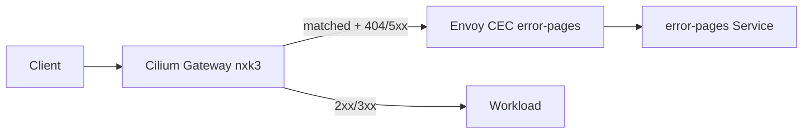

# ADR-0024: Error-Pages (Maintenance)

- **Status:** Accepted (superseded wiring: Traefik → Cilium CEC; see [ADR-0038](0038-cilium-gateway-api.md))
- **Datum:** 2026-09-27
- **Update:** 2026-11-05 — Gateway API cutover
- **Kontext:** `apps/infra/error-pages/`, Issue [HenryHST/minilab#83](https://github.com/HenryHST/minilab/issues/83); Upstream [tarampampam/error-pages](https://github.com/tarampampam/error-pages)

## Kontext

Bei Backend-Ausfällen und unbekannten Hosts sollen Homelab-Nutzer eine klare Maintenance-/Error-Seite mit Link zu Status und Homepage sehen.

## Entscheidung

- **Ownership:** GitOps via ApplicationSet `infra` + native Argo Helm OCI ([ADR-0014](0014-helm-strategie.md)), Namespace `error-pages`, sync wave `1`.
- **Chart:** `error-pages` (`ghcr.io/tarampampam/error-pages/charts`); Pin: `applicationset-infra.yaml` → `helmVersion`.
- **HTML:** Custom-Template auf Basis `lost-in-space` mit festem Satz öffentlicher Gatus-Health-Badges (`config.htmlTemplate.custom` + ConfigMap-Mount). Status-Link → `/uebersicht`. Kein Kromgo auf der Error-Page.
- **Edge (ab ADR-0038):** Kein Traefik Middleware / HostRegexp-Catch-all mehr. Infra_LAB `cni_cilium` installiert Cilium Envoy CEC für Statuscodes **404** und **500–504** gegen Service `error-pages`/`error-pages`. `sendSameHttpCode`-Semantik bleibt Ziel (echte Statuscodes an den Client).

## Konsequenzen

- Gestylte Seiten bei 404/502/503 o. Ä.; unbekannte Hostnamen ohne TLS-Listener scheitern weiterhin am Gateway (kein Wildcard-Listener).
- error-pages Helm-Release muss vor/mit CEC erreichbar sein (sync wave `1`; Gateway wave `0`).
- Kein Pangolin-Publish; Fehlerseiten nur hinter Cluster-Gateway.
