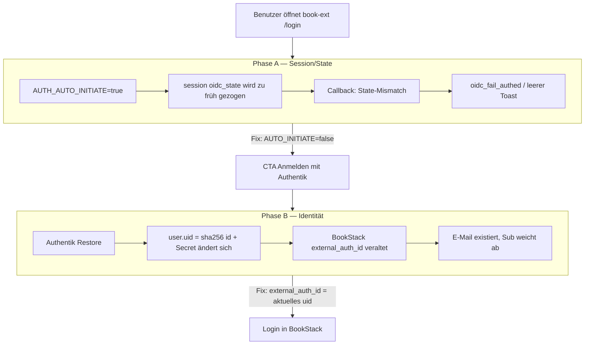
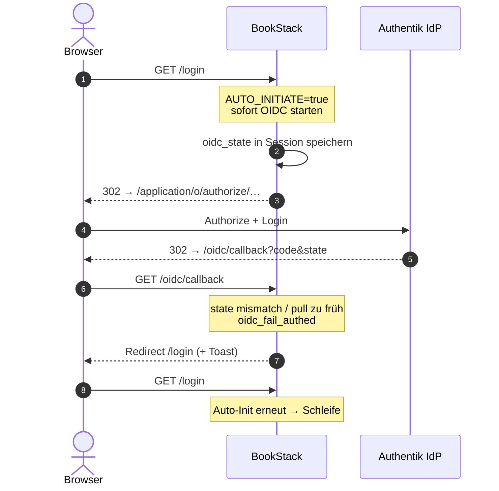
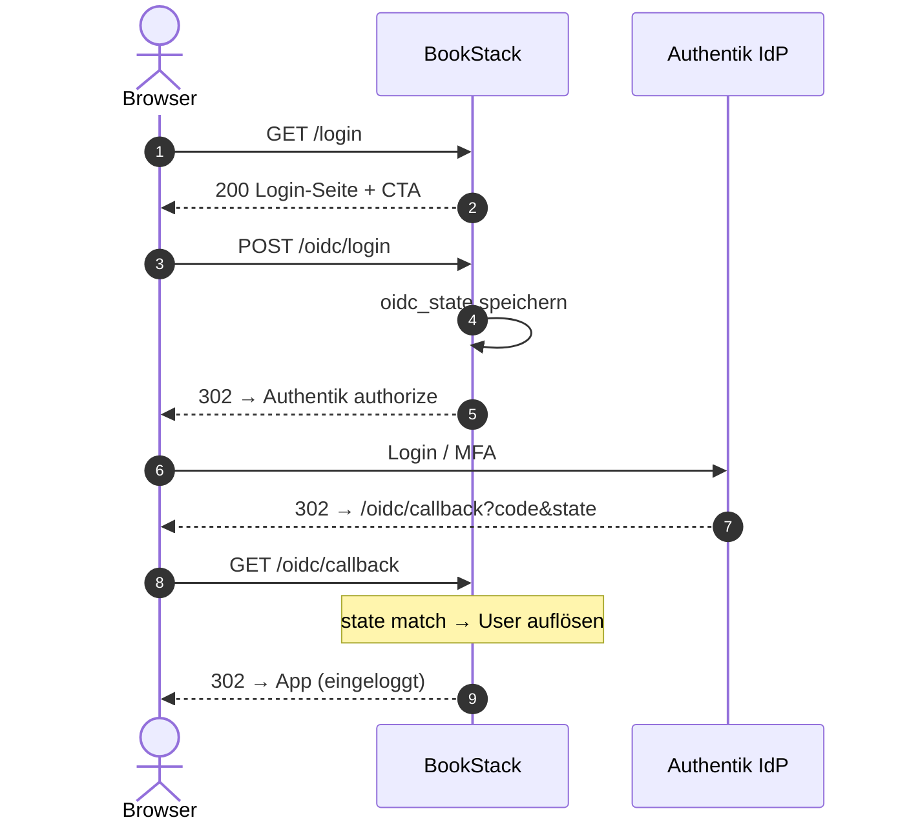
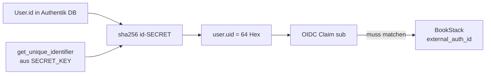
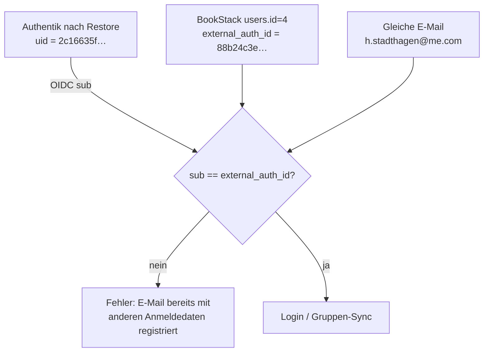

# OIDC-Login Fehleranalyse

> **Buch** v1.2.0 · Stand: 2026-10-19 · Incident 2026-10-19

Zwei unabhängige Ursachen verhinderten den Login über Authentik (Symptome: leerer Fehler-Toast, Redirect-Schleife, danach „E-Mail bereits mit anderen Anmeldedaten registriert“). Der OIDC-Handshake selbst (Authorize → Callback) war nach dem ersten Fix intakt; der zweite Fehler lag in der **Identitätsverknüpfung** nach einem Authentik-Restore.

## Symptome

| Phase | Symptom | Typische Beobachtung |
|--|--|--|
| A | Login scheitert sofort | Toast ohne/mit leerem Text; Callback ↔ `/login`-Schleife |
| A | Auto-Redirect | `/login` springt ohne Klick zu Authentik |
| B | Nach erfolgreichem Authentik-Login | *Ein Benutzer mit der E-Mail-Adresse … ist bereits mit anderen Anmeldedaten registriert.* |
| — | Abgrenzung | Authentik-Backup/Restore war **nicht** die Ursache von Phase A |

## Übersicht der Ursachen



---

## Phase A — OIDC-State-Race (`AUTH_AUTO_INITIATE`)

### Soll vs. Ist (Sequenz)

**Kaputt** (`AUTH_AUTO_INITIATE=true`): BookStack startet OIDC sofort beim Laden von `/login`. Authentik antwortet schnell; der gespeicherte `oidc_state` wird per `session()->pull` verbraucht, bevor der Browser den Callback korrekt abschließt → State-Mismatch und erneuter Auto-Init (Schleife).



**Fix** (`AUTH_AUTO_INITIATE=false`): Login-Seite bleibt stehen; OIDC startet erst per Button **Anmelden mit Authentik** (POST `/oidc/login`). State bleibt bis zum Callback gültig.



### Hypothesen (Phase A)

| Hypothese | Ergebnis | Evidenz |
|--|--|--|
| Auto-Initiate + schneller IdP-Return verbraucht `oidc_state` | **bestätigt** | Schleife / Toast; nach `AUTH_AUTO_INITIATE=false` bleibt `/login` bei **200** ohne Authentik-`Location` |
| Pangolin/Cookie allein kaputt | **verworfen** (für Curl-Pfad) | Cookie-Jar + manueller OIDC-Start: **302** zu `idp` mit `state=` |
| Authentik-Restore hat OIDC zerstört | **verworfen** für Phase A | Provider/Secret ok; Problem war GitOps-Env |

### Fix (GitOps)

| Maßnahme | Wo |
|--|--|
| `AUTH_AUTO_INITIATE: "false"` | [`apps/dev/bookstack/values.yaml`](../../../../apps/dev/bookstack/values.yaml) + regeneriertes `helm-manifest.yaml` |
| PR / Sync | minilab PR #148 → Argo Application `bookstack` |

Verify im Pod: `printenv AUTH_AUTO_INITIATE` → `false`. UI: `/login` zeigt **Anmelden mit Authentik**, kein Sofort-Redirect.

---

## Phase B — `external_auth_id` drift nach Authentik-Restore

Nach behobenem Auto-Initiate erschien der Klartextfehler zur E-Mail. BookStack vergleicht die OIDC-Claim `sub` (`OIDC_EXTERNAL_ID_CLAIM=sub`) mit `users.external_auth_id`. Authentik liefert bei `sub_mode=hashed_user_id` den Wert `user.uid`.

### Wie Authentik `sub` bildet



`user.uid` in Authentik (vereinfacht):

```text
uid = sha256( f"{user.id}-{get_unique_identifier()}" )
```

Ändert sich **User-PK** und/oder der aus `AUTHENTIK_SECRET_KEY` abgeleitete Identifier (z. B. nach Restore mit anderem Secret oder neu angelegten Usern), ändert sich `sub` — BookStack behält den alten Hash.

### Datenfluss Konflikt



### Hypothesen (Phase B)

| Hypothese | Ergebnis | Evidenz |
|--|--|--|
| Gespeichertes `external_auth_id` ≠ live `user.uid` | **bestätigt** | Henry: DB `88b24c3e…` vs. Authentik `2c16635f…` (beide 64 Hex); Markus analog drift |
| Lokales Passwort blockiert OIDC | **verworfen** | Konflikt ist E-Mail + abweichende External-ID |
| Provider/`OIDC_CLIENT_SECRET` kaputt | **verworfen** | POST `/oidc/login` → 302 IdP; Secret-Länge ok; Authentik „Log in to continue to BookStack“ |
| Restore-Zeitfenster | **bestätigt** | Job `authentik-bootstrap-restore` kurz vor dem Incident |

### Fix (Live-DB, einmalig)

Für betroffene OIDC-User `external_auth_id` auf das **aktuelle** Authentik-`user.uid` setzen (E-Mail-Match). Beispiel-Ermittlung in Authentik:

```bash
kubectl -n authentik exec deploy/authentik-worker -c worker -- ak shell
# >>> from authentik.core.models import User
# >>> User.objects.get(email="…").uid
```

Dann in MariaDB (Namespace `bookstack`):

```sql
UPDATE users
SET external_auth_id = '<aktuelles-authentik-uid>'
WHERE email = '<email>';
```

Am 2026-10-19 aktualisiert: Henry + Markus (Marion hatte noch keinen BookStack-User).

### Dauerhafte Absicherung (Empfehlung)

| Option | Vorteil | Nachteil |
|--|--|--|
| Nach jedem Authentik-Restore mit Secret-/User-Drift: Relink-Skript | Kein Provider-Umbau | Manuell / Runbook |
| Terraform `sub_mode` → `user_uuid` + einmalig `external_auth_id` = UUID | Stabil über Secret-Rotation | Alle App-Links einmal migrieren |

Aktuell bleibt `hashed_user_id` (Terraform BookStack-OAuth). **SECRET_KEY** und User-PKs bei Restore strikt mitführen (siehe Authentik Backup/Verify).

---

## Soll-Zustand / Verify

```text
Browser  --HTTPS-->  book-ext (Pangolin) / book (LAN)
                         |
                         v
              BookStack  AUTH_AUTO_INITIATE=false
                         OIDC_EXTERNAL_ID_CLAIM=sub
                         |
            POST /oidc/login  -->  Authentik bookstack provider
                         |              sub_mode=hashed_user_id
                         v              sub = user.uid
              /oidc/callback  -->  users.external_auth_id match
                         |
                         v
                    Session + Gruppen (OIDC groups → Rollen)
```

Schnellchecks:

```bash
# Env
kubectl -n bookstack exec deploy/bookstack -c bookstack -- printenv AUTH_AUTO_INITIATE
# → false

# Login-Seite ohne Auto-Redirect
curl -sSI https://book-ext.stadthagen.dev/login | head -5
# → HTTP/2 200, kein Location zu idp

# Identität (bei Bedarf)
# Authentik uid vs. BookStack external_auth_id für dieselbe E-Mail vergleichen
```

UI: Incognito → `/login` → **Anmelden mit Authentik** → MFA → BookStack-Home **ohne** Toast/E-Mail-Konflikt.

## Runbook bei Regression

1. **Leerer Toast / Redirect-Schleife:** `AUTH_AUTO_INITIATE` prüfen; GitOps darf nicht wieder auf `true` healen.
2. **E-Mail bereits registriert:** Authentik `user.uid` vs. `users.external_auth_id` vergleichen; nach Restore Relink.
3. **302/401 am IdP:** Client-Secret, Redirect-URIs (`book` + `book-ext`), Provider-Slug `bookstack`.
4. Authentik-Restore: `AUTHENTIK_SECRET_KEY` und User-IDs dokumentieren; MFA und gehashte `sub`s hängen daran.
