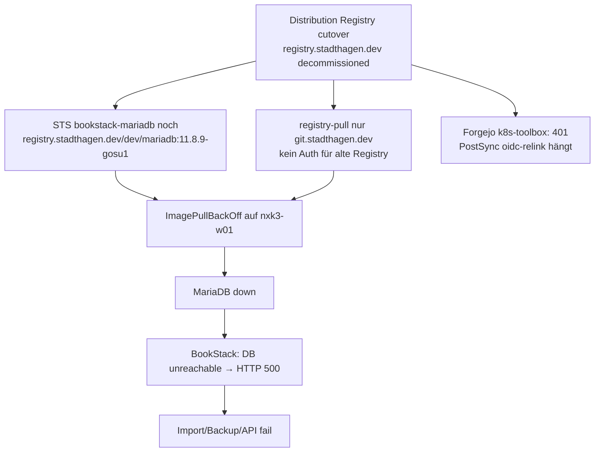

# MariaDB ImagePull Fehleranalyse

> **Buch** v1.4.0 · Stand: 2026-10-28 · Incident 2026-10-28

Nach dem Cutover der Lab-OCI von Distribution (`registry.stadthagen.dev`) auf Forgejo (`git.stadthagen.dev`) blieb BookStack **Degraded**: die App antwortete mit HTTP 500, Docs-Import und Backup scheiterten. Ursache war kein BookStack-Bug, sondern ein **nicht mitgezogenes MariaDB-Image** plus nachgelagerte Pull-/Hook-Effekte.

## Symptome

| Schicht | Beobachtung |
|--|--|
| Argo | Application `bookstack` **Synced** / **Degraded** |
| Pods | `bookstack-mariadb-0` → `ImagePullBackOff` |
| App | `Waiting for DB` / `SQLSTATE[HY000] [2002] Host is unreachable` (Host `bookstack-mariadb`) |
| HTTP | `wget` im App-Pod → **500**; Login-Pfad tot, bis DB wieder läuft |
| Jobs | Docs-Import → API **500** auf `/api/shelves`; Backup-Cron teils **Error** |
| Hooks | PostSync `bookstack-oidc-relink` → `ErrImagePull` auf `k8s-toolbox` → Sync blieb auf „waiting for hook“ |

## Ursachenkette



### Primär: MariaDB-Image auf toter Registry

| | |
|--|--|
| Manifest | [`apps/dev/bookstack/mariadb.yaml`](../../../../apps/dev/bookstack/mariadb.yaml) |
| Alt | `registry.stadthagen.dev/dev/mariadb:11.8.9-gosu1` (gosu-CVE-Rebuild) |
| Pull-Secret | `registry-pull` → nur Host `git.stadthagen.dev` |
| Event | `pull access denied … no basic auth credentials` bzw. Repo unerreichbar |
| Cache | Auch auf `nxk3-w01` (nodeSelector) **kein** lokales Image mehr → `IfNotPresent` half nicht |

Forgejo hatte **kein** Package/Repo `dev/mariadb` (Day-2 OpenTofu kannte nur `vw-restore`, `podcraft`, `k8s-toolbox`). Ein Retarget auf `git.stadthagen.dev/dev/mariadb:…` allein hätte ohne Build/Push und ohne gültigen Pull-Token ebenfalls fehlgeschlagen.

### Sekundär: Forgejo OCI 401 für `k8s-toolbox`

| | |
|--|--|
| Image | `git.stadthagen.dev/ops/k8s-toolbox:1.0.1` |
| Symptom | `failed to fetch oauth token … 401 Unauthorized` |
| Wirkung | PostSync-Jobs (`oidc-relink`, frische Pulls) scheitern; Nodes mit altem Cache konnten kurz noch starten |
| Hinweis | `REGISTRY_PASSWORD` / `registry-pull` nach Token-Rotate in App-Namespaces teils veraltet; BookStack fehlte lange in der `k3s_secrets`-Liste für `registry-pull` |

## Fix (2026-10-28)

### Sofort — DB wieder erreichbar

1. StatefulSet-Image auf öffentliches **`mariadb:11.8.9`** (Docker Hub), `imagePullSecrets` für diesen STS entfernt.
2. Pod neu erzeugen; BookStack Deployment rollen.
3. Verify: App-Pod → `/login` **302/200**; MariaDB Ready.

Git: minilab Commit *Fix BookStack MariaDB after Distribution registry cutover* (`mariadb.yaml`, README unter `mariadb-image/`).

> Interim: CVE-Hygiene (gosu-Rebuild) ist bewusst zurückgestellt, bis das Image in Forgejo liegt.

### PostSync nicht mehr blockieren

`bookstack-oidc-relink` (Default `enabled=false`):

- Skip-Pfad läuft auf öffentlichem **`alpine:3.22`** und beendet mit Exit 0, **ohne** Forgejo-Pull.
- `enabled=true` braucht weiterhin Toolbox + funktionierenden `registry-pull` (sonst klarer Fehlertext).

### Infra vorbereiten

| Schritt | Ort |
|--|--|
| Repo `dev/mariadb` in Forgejo Day-2 | Infra_LAB `terraform/forgejo` Variable `repositories` |
| `registry-pull` auch Namespace `bookstack` | Infra_LAB `k3s_secrets` defaults |

## Verify

```bash
kubectl -n bookstack get sts bookstack-mariadb -o jsonpath='{.spec.template.spec.containers[0].image}{"\n"}'
# erwartet: mariadb:11.8.9

kubectl -n bookstack get pods -l 'app in (bookstack,bookstack-mariadb)'
kubectl -n bookstack exec deploy/bookstack -- wget -qO- -T 5 -S http://127.0.0.1:80/ 2>&1 | head -20
# erwartet: 302 → Login / 200

kubectl -n argocd get application bookstack
# bei hängendem „waiting for hook“: Sync in Argo UI terminieren, dann erneut syncen
```

## Follow-up

1. **Forgejo Pull-Auth** — Token neu minten (`forgejo-bootstrap` / Output `registry_pull_token` → SecretSpec `REGISTRY_PASSWORD`) und `ansible-playbook … --tags secrets` (aktualisiert u. a. `bookstack/registry-pull`).
2. **gosu-Image** — Build/Push `git.stadthagen.dev/dev/mariadb:11.8.9-gosu1` (siehe [`mariadb-image/README.md`](../../../../apps/dev/bookstack/mariadb-image/README.md)), danach `mariadb.yaml` umstellen.
3. **Hooks** — Docs-Import/Theme/Backup brauchen wieder pullbares `k8s-toolbox`; bis dahin schlagen frische Job-Pulls fehl, auch wenn die Wiki-UI schon grün ist.

## Abgrenzung

| Nicht Ursache | Warum |
|--|--|
| BookStack-Image / linuxserver-Tag | App-Pod war Running; Fehler war DB-Connectivity |
| TLS / Ingress / Pangolin | Zertifikat Ready; Ausfall war cluster-intern vor Traefik |
| OIDC Relink-Logik | Hook hing am ImagePull, nicht an `external_auth_id` |
