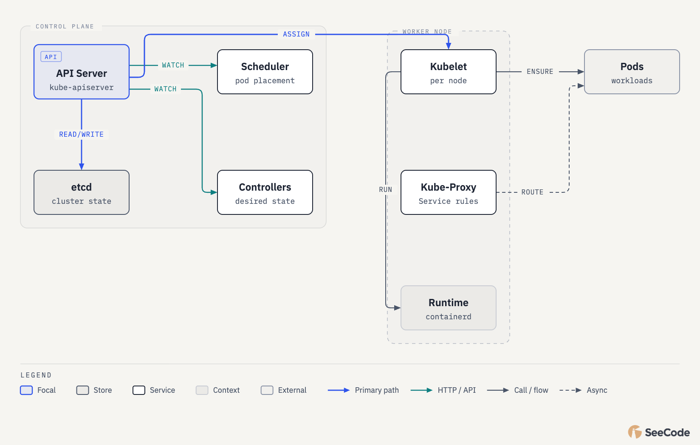
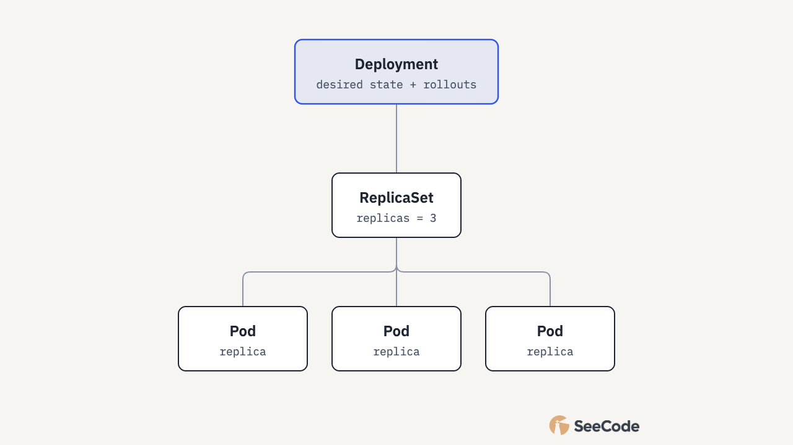
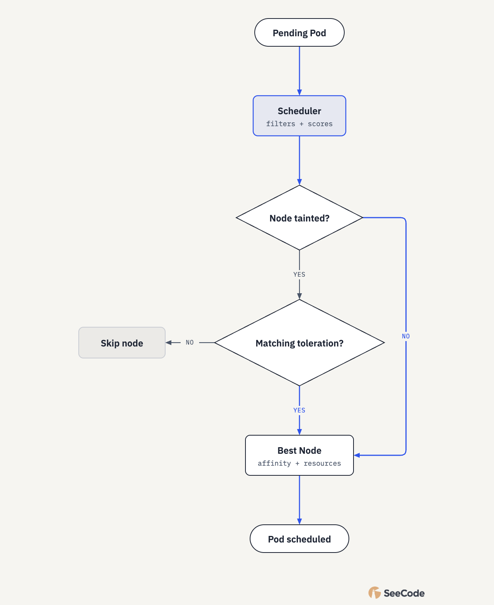
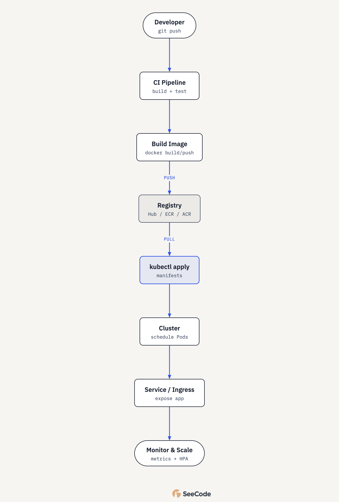

# Kubernetes Complete Notes

Beginner-to-advanced reference: architecture, workloads, networking, storage, scheduling, security, kubectl, and end-to-end workflow.

Related sheets: [Kubernetes Q&A](27-k8s_qa.md) · [kubectl](28-kubectl.md)

> Based on educational notes by Rakesh Kumar (adapted to Markdown; diagrams recreated).

---

## 1. What is Kubernetes?

Kubernetes (K8s) is an **open-source container orchestration platform** that automates deployment, scaling, and management of containerized applications. It groups containers into logical units for discovery and operations.

### Why Kubernetes?

- Manage containers at scale
- Automate deployment, scaling, and operations
- High availability and reliability
- Better resource utilization
- Portability across cloud, on-prem, and hybrid

### Key features

| # | Feature | Summary |
| --- | --- | --- |
| 1 | Automation | Deploy, scale, and manage workloads |
| 2 | Scalability | Scale up/down with demand |
| 3 | Self-healing | Restart, replace, or reschedule failed containers |
| 4 | High availability | Replication and failover |
| 5 | Load balancing | Distribute traffic across Pods |
| 6 | Service discovery | Discover services and endpoints |
| 7 | Rolling updates & rollbacks | Update without downtime; revert if needed |
| 8 | Portability | On-prem, cloud, or hybrid |

### Common use cases

- Deploy and manage microservices
- Run stateless and stateful applications
- Handle traffic spikes with auto-scaling
- Multi-environment deployments (dev / test / prod)

---

## 2. Architecture

A cluster is a **control plane** (master) plus **worker nodes**. The control plane decides; workers run Pods.



### Control plane

| Component | Role |
| --- | --- |
| API Server | Exposes the Kubernetes API; central communication hub |
| etcd | Consistent, highly available key-value store for cluster state |
| Scheduler | Assigns Pods to nodes based on resources and rules |
| Controller Manager | Runs controllers that maintain desired state |
| Cloud Controller Manager | Integrates with cloud provider resources (optional) |

### Worker node

| Component | Role |
| --- | --- |
| Kubelet | Ensures containers run as defined in the Pod |
| Kube-Proxy | Maintains network rules for Services |
| Container runtime | Runs containers (e.g. containerd) |
| Pods | Smallest deployable units on the node |

**Remember:** Control plane thinks; worker nodes do the work.

---

## 3. Core components

| Component | Summary |
| --- | --- |
| API Server | Frontend of the control plane; all clients talk here (`kubectl`, UI, controllers) |
| etcd | Stores cluster state, config, and metadata |
| Scheduler | Watches unscheduled Pods and picks the best node |
| Controller Manager | Closes the gap between desired and actual state (Node, ReplicaSet, Endpoint, …) |
| Kubelet | Per-node agent; talks to the API Server and the runtime |
| Kube-Proxy | Per-node networking for Services → Pods |

Together these keep the cluster healthy, scalable, and self-healing.

---

## 4. Pods, ReplicaSet, Deployment

### Pod

- Smallest deployable unit
- One or more containers sharing network, storage, and config
- Ephemeral (created, destroyed, recreated)
- Own IP; talks to other Pods / Services

### ReplicaSet

- Keeps a specified number of identical Pod replicas running
- Replaces failed Pods to match the desired count

### Deployment

- Manages ReplicaSets
- Declarative updates, scaling, rolling updates, and rollbacks



### Rolling update

Gradual replacement with **zero downtime**: new Pods start before old ones stop.

Example with 3 replicas: `v1 v1 v1` → `v1 v1 v2` → `v1 v2 v2` → `v2 v2 v2`.

### Rollback

Revert a Deployment to a previous ReplicaSet / version if a rollout fails.

```bash
kubectl rollout status deploy/<name>
kubectl rollout history deploy/<name>
kubectl rollout undo deploy/<name>
```

| Concept | Role |
| --- | --- |
| Pod | Smallest unit |
| ReplicaSet | Maintains desired Pod count |
| Deployment | Manages ReplicaSets, updates, scaling |
| Rolling update | Zero-downtime updates |
| Rollback | Revert to a stable version |

---

## 5. Services

A Service is a **stable network endpoint** for a set of Pods. It provides load balancing, service discovery, and a stable IP/DNS name.

**Why Services?** Stable endpoint despite ephemeral Pods; load balancing; discovery; decouple frontend and backend.

| Type | Access | Notes |
| --- | --- | --- |
| **ClusterIP** | Cluster-internal only | Default if `type` omitted |
| **NodePort** | `<NodeIP>:<NodePort>` | Port range typically 30000–32767; opens on every node |
| **LoadBalancer** | Cloud LB external IP | Provisions a cloud load balancer where supported |
| **Ingress** | HTTP/HTTPS host/path rules | Needs an Ingress Controller (NGINX, Traefik, …); L7 routing |

Ingress example rules:

- `app1.example.com /` → Service A
- `app2.example.com /` → Service B
- `example.com /api` → Service C

---

## 6. Namespaces, Labels, Selectors, ConfigMap & Secret

### Namespaces

Logical isolation of resources for teams or projects. Resources in one namespace do not access another by default.

Default namespaces: `default`, `kube-system`, `kube-public`, `kube-node-lease`.

Typical pattern: separate `dev` / `test` / `prod` (each with its own Pods, Services, ConfigMaps).

### Labels

Key-value metadata on objects for organization and selection.

Examples: `app=frontend`, `env=prod`, `tier=web`, `version=v1`, `component=backend`.

### Selectors

Filter resources by labels. Used by Services, ReplicaSets, and Deployments to find Pods.

- **Equality-based:** `app=frontend`
- **Set-based:** `env in (prod, staging)`

### ConfigMap

Non-confidential config as key-value data. Consumed as env vars, CLI args, or mounted files.

```yaml
apiVersion: v1
kind: ConfigMap
metadata:
  name: app-config
data:
  APP_NAME: my-app
  APP_ENV: dev
  LOG_LEVEL: info
```

### Secret

Sensitive data (passwords, tokens, keys). Stored **base64-encoded** by default — that is **not encryption**. Prefer encryption at rest / external secret stores in production.

```yaml
apiVersion: v1
kind: Secret
metadata:
  name: db-secret
type: Opaque
data:
  DB_USER: cm9vdA==
  DB_PASSWORD: cGFzc3dvcmQ=
```

| Concept | Role |
| --- | --- |
| Namespaces | Divide and isolate |
| Labels | Key-value metadata |
| Selectors | Find / filter by labels |
| ConfigMap | Non-confidential config |
| Secret | Sensitive data (base64) |

---

## 7. Volumes, PV, PVC & StorageClass

Volumes give Pods storage that can outlive a container restart and be shared between containers in a Pod.

**Why volumes?** Persist data beyond the Pod lifecycle; stateful apps; share data; support backends (EBS, NFS, local, …).

### Volume types (examples)

`emptyDir`, `hostPath`, `configMap`, `secret`, `persistentVolumeClaim`, …

### PersistentVolume (PV)

Cluster-scoped storage provisioned by an admin or dynamically via a StorageClass. Independent of any single Pod.

```yaml
apiVersion: v1
kind: PersistentVolume
metadata:
  name: pv-demo
spec:
  capacity:
    storage: 5Gi
  accessModes: ["ReadWriteOnce"]
  persistentVolumeReclaimPolicy: Retain
  hostPath:
    path: /data/pv-demo
```

### PersistentVolumeClaim (PVC)

Namespaced request for storage. Binds to a matching PV; Pods mount the claim.

```yaml
apiVersion: v1
kind: PersistentVolumeClaim
metadata:
  name: pvc-demo
spec:
  accessModes: ["ReadWriteOnce"]
  resources:
    requests:
      storage: 5Gi
```

### StorageClass

Defines how to **dynamically** provision PVs (provisioner + parameters).

Flow: `PVC (request)` → `StorageClass (provisioner)` → `PV (created)` → bind → mount in Pod.

```yaml
apiVersion: storage.k8s.io/v1
kind: StorageClass
metadata:
  name: gp2-storage
provisioner: kubernetes.io/aws-ebs
parameters:
  type: gp2
  fsType: ext4
reclaimPolicy: Delete
volumeBindingMode: WaitForFirstConsumer
```

| Concept | Role |
| --- | --- |
| Volume | Share / attach storage in a Pod |
| PV | Cluster-level storage |
| PVC | Request that binds to a PV |
| StorageClass | Dynamic provisioning |

---

## 8. StatefulSet, DaemonSet, Job & CronJob

### StatefulSet

Stateful apps with stable network identity and persistent storage. Pods created in order (`pod-0`, `pod-1`, …) and deleted in reverse. Examples: MySQL, MongoDB, Kafka.

```yaml
apiVersion: apps/v1
kind: StatefulSet
metadata:
  name: mysql
spec:
  serviceName: mysql
  replicas: 3
  selector:
    matchLabels:
      app: mysql
  template:
    metadata:
      labels:
        app: mysql
```

### DaemonSet

One Pod (or selected nodes) **per node** — logging, monitoring, CNI agents. New nodes get a Pod automatically.

```yaml
apiVersion: apps/v1
kind: DaemonSet
metadata:
  name: fluentd
spec:
  selector:
    matchLabels:
      app: fluentd
  template:
    metadata:
      labels:
        app: fluentd
```

### Job

Pods that **run to completion**. Batch work, migrations. Failed Pods may retry per backoff policy. Use `restartPolicy: OnFailure` or `Never`.

```yaml
apiVersion: batch/v1
kind: Job
metadata:
  name: data-migration
spec:
  completions: 1
  template:
    spec:
      containers:
        - name: migrator
          image: my-app
      restartPolicy: OnFailure
```

### CronJob

Creates Jobs on a schedule (`*/5 * * * *` = every 5 minutes). Backups, reports, cleanup.

```yaml
apiVersion: batch/v1
kind: CronJob
metadata:
  name: backup-job
spec:
  schedule: "*/5 * * * *"
  jobTemplate:
    spec:
      template:
        spec:
          containers:
            - name: backup
              image: my-backup
          restartPolicy: OnFailure
```

| Workload | Purpose | Key points | Examples |
| --- | --- | --- | --- |
| StatefulSet | Stateful apps | Stable identity, ordered, PVCs | Databases, Kafka |
| DaemonSet | Per-node agents | One Pod per node | Logging, monitoring, CNI |
| Job | Run once | Completes then stops | Batch, migration |
| CronJob | Scheduled Jobs | Cron expression | Backups, cleanup |

**Think:** Deployment = stateless · StatefulSet = stateful · Job/CronJob = tasks · DaemonSet = nodes.

---

## 9. Scheduling

Scheduling assigns Pods to Nodes based on resources, policies, and constraints.

Flow: Pending Pod → Scheduler → best Node → Pod scheduled.



### NodeSelector

Simple exact label match on the node.

```yaml
spec:
  nodeSelector:
    disktype: ssd
    env: prod
```

### Affinity

Richer rules; hard (`required…`) or soft (`preferred…`).

- **nodeAffinity** — place on nodes with certain labels
- **podAffinity** — place near matching Pods
- **podAntiAffinity** — place away from matching Pods

```yaml
affinity:
  nodeAffinity:
    requiredDuringSchedulingIgnoredDuringExecution:
      nodeSelectorTerms:
        - matchExpressions:
            - key: disktype
              operator: In
              values: [ssd]
```

### Taints & Tolerations

- **Taints** (on Nodes) repel Pods without a matching toleration — reserve nodes for specific workloads
- **Tolerations** (on Pods) allow scheduling onto matching tainted nodes

```bash
kubectl taint nodes node1 dedicated=api:NoSchedule
```

```yaml
tolerations:
  - key: "dedicated"
    operator: "Equal"
    value: "api"
    effect: "NoSchedule"
```

| Effect | Behavior |
| --- | --- |
| `NoSchedule` | Do not schedule new Pods without toleration |
| `PreferNoSchedule` | Prefer to avoid the node |
| `NoExecute` | Evict existing Pods that do not tolerate |

| Concept | Applies to | Purpose |
| --- | --- | --- |
| NodeSelector | Pod | Simple label-based placement |
| Affinity | Pod | Advanced near / away / node rules |
| Taints | Node | Repel Pods |
| Tolerations | Pod | Allow Pods onto tainted nodes |

**Tip:** Taints control which Pods can land on a node; tolerations allow those Pods onto tainted nodes.

---

## 10. Security

Goals: authentication (who), authorization (what), isolation, audit & monitoring.

### RBAC

Controls who can act on which resources. Use **Roles** (namespaced) and **ClusterRoles** (cluster-wide); bind to users, groups, or ServiceAccounts. Prefer least privilege.

```yaml
apiVersion: rbac.authorization.k8s.io/v1
kind: Role
metadata:
  name: pod-reader
  namespace: dev
rules:
  - apiGroups: [""]
    resources: ["pods"]
    verbs: ["get", "list", "watch"]
---
apiVersion: rbac.authorization.k8s.io/v1
kind: RoleBinding
metadata:
  name: read-pods
  namespace: dev
subjects:
  - kind: User
    name: alice
    apiGroup: rbac.authorization.k8s.io
roleRef:
  kind: Role
  name: pod-reader
  apiGroup: rbac.authorization.k8s.io
```

### ServiceAccount

Identity for processes in Pods talking to the API. Each namespace has a `default` SA — create dedicated ones with least privilege.

```yaml
apiVersion: v1
kind: ServiceAccount
metadata:
  name: my-sa
  namespace: dev
---
apiVersion: v1
kind: Pod
metadata:
  name: my-pod
  namespace: dev
spec:
  serviceAccountName: my-sa
  containers:
    - name: app
      image: nginx
```

### NetworkPolicy

Controls Pod ingress/egress by Pod selectors, namespaces, CIDRs, and ports. Requires a CNI that enforces policies.

```yaml
apiVersion: networking.k8s.io/v1
kind: NetworkPolicy
metadata:
  name: allow-frontend-to-backend
  namespace: app
spec:
  podSelector:
    matchLabels:
      app: backend
  policyTypes:
    - Ingress
  ingress:
    - from:
        - podSelector:
            matchLabels:
              app: frontend
      ports:
        - protocol: TCP
          port: 80
```

### Practices

- Avoid `cluster-admin` for day-to-day use
- Dedicated ServiceAccounts per workload
- Restrict traffic with NetworkPolicies
- Keep auditing and monitoring on

| Piece | Role |
| --- | --- |
| RBAC | What you can do |
| ServiceAccount | Identity for apps |
| NetworkPolicy | How Pods communicate |
| Least privilege | Defense in depth |

---

## 11. kubectl essentials

Abbreviations: `ns`, `po`, `svc`, `deploy`, `rs`, `cm`, `ing`, `pv`, `pvc`, `ds`, `sts`.

Useful flags: `-n <ns>`, `-A` / `--all-namespaces`, `-o wide|yaml|json`, `-w`, `-l <selector>`.

| # | Command | Purpose |
| --- | --- | --- |
| 1 | `kubectl version` | Client & server version |
| 2 | `kubectl cluster-info` | Cluster endpoints |
| 3 | `kubectl get nodes` | List nodes |
| 4 | `kubectl get nodes -o wide` | Nodes with extra columns |
| 5 | `kubectl get pods` | Pods in current namespace |
| 6 | `kubectl get pods -A` | Pods in all namespaces |
| 7 | `kubectl get pods -o wide` | Pods with node/IP |
| 8 | `kubectl describe pod <pod>` | Pod details & events |
| 9 | `kubectl logs <pod>` | Container logs |
| 10 | `kubectl logs -f <pod>` | Stream logs |
| 11 | `kubectl exec -it <pod> -- /bin/sh` | Shell in Pod |
| 12 | `kubectl get all` | Common resources in ns |
| 13 | `kubectl get all -A` | Common resources all ns |
| 14 | `kubectl get svc` | Services |
| 15 | `kubectl describe svc <svc>` | Service details |
| 16 | `kubectl get deploy` | Deployments |
| 17 | `kubectl describe deploy <deploy>` | Deployment details |
| 18 | `kubectl rollout status deploy/<d>` | Rollout progress |
| 19 | `kubectl rollout history deploy/<d>` | Revision history |
| 20 | `kubectl rollout undo deploy/<d>` | Rollback |
| 21 | `kubectl get ns` | Namespaces |
| 22 | `kubectl get cm` / `secret` | ConfigMaps / Secrets |
| 23 | `kubectl get pv` / `pvc` | Storage |
| 24 | `kubectl get ingress` | Ingress |
| 25 | `kubectl top nodes` / `top pods` | Resource usage |
| 26 | `kubectl apply -f <file.yaml>` | Create/update |
| 27 | `kubectl delete -f <file.yaml>` | Delete from file |
| 28 | `kubectl delete pod <pod>` | Delete a Pod |
| 29 | `kubectl drain <node> --ignore-daemonsets` | Prep node for maintenance |
| 30 | `kubectl get rs` | ReplicaSets |

Pattern: `kubectl <verb> <resource>`. Prefer `describe` and `logs` for troubleshooting; `apply` for idempotent changes. Fuller command lists: [kubectl](28-kubectl.md).

---

## 12. End-to-end workflow



| Step | Action | Typical tools |
| --- | --- | --- |
| 1 Developer | Write code, commit, push | git, GitHub/Forgejo |
| 2 CI | Build, test, scan | Jenkins, GitLab CI, GitHub Actions |
| 3 Image | Build and push image | `docker build` / `push` |
| 4 Registry | Store images | Docker Hub, ECR, ACR, Harbor |
| 5 Deploy | Apply manifests | `kubectl apply -f` |
| 6 Cluster | Schedule and run Pods | Scheduler, kubelet |
| 7 Expose | Service / Ingress | ClusterIP, NodePort, LB, Ingress |
| 8 Operate | Metrics, logs, scale | Prometheus, Grafana, HPA |

### Resources in a typical app flow

- Deployment / StatefulSet — app controller
- Pod — running unit
- Service — stable networking
- ConfigMap / Secret — config and secrets
- PVC — storage claim
- Ingress — HTTP/HTTPS routing
- NetworkPolicy — traffic rules
- ServiceAccount + RBAC — identity and access

---

## Key takeaways

- **Namespaces** isolate; **labels/selectors** organize and target
- **Deployment** for stateless; **StatefulSet** for identity + storage; **DaemonSet** per node; **Job/CronJob** for tasks
- **Services** stabilize networking; **Ingress** for L7 HTTP routing
- **PV/PVC/StorageClass** separate request from provisioned storage
- **Taints/tolerations** and **affinity** steer placement
- **RBAC + SA + NetworkPolicy** for least privilege and isolation
- Practice YAML; use `kubectl describe` / `logs` / `events` when debugging

Interview-style Q&A: [Kubernetes Q&A](27-k8s_qa.md). Daily CLI: [kubectl](28-kubectl.md).
