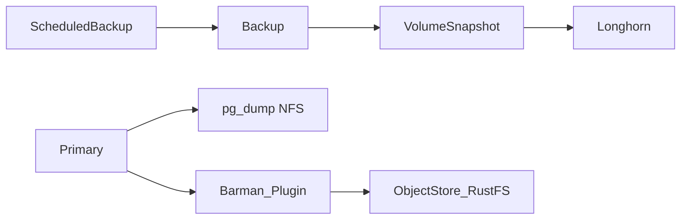

# Architektur

## Operator

- Helm-Release `cloudnative-pg` aus `https://cloudnative-pg.github.io/charts`, Values `apps/infra/cloudnative-pg/values.yaml`.
- `config.clusterWide: true`. Der Operator sieht `Cluster` in jedem Namespace.
- ServiceAccount `postgres-cloud-sa`. ClusterRole und Binding kommen aus dem Chart. Kein zusätzliches User-ClusterRole. `rbac.aggregateClusterRoles` bleibt aus.
- Requests 50m CPU / 128Mi, Limit 256Mi.
- Webhook-Zertifikate bleiben im Chart (`cnpg-webhook-service:443` → Pod `:9443`). cert-manager für `Cluster.spec.certificates` ist nicht eingerichtet.
- Grafana-Dashboard kommt nicht aus dem Operator-Chart. Application `cnpg-grafana` (Chart `cluster`; Pin: `applicationset-monitoring.yaml` → `helmVersion`) legt ConfigMap `cnpg-grafana-dashboard` in `monitoring` ab, Label `grafana_dashboard=1`.

## NetworkPolicy

Pod-Selector `app.kubernetes.io/name=cloudnative-pg`.

| Richtung | Port | Wer |
|----------|------|-----|
| Ingress | 9443 | kube-apiserver, beliebige Quelle |
| Ingress | 8080 | nur Namespace `monitoring` |
| Egress | 53 UDP/TCP | DNS |
| Egress | 443, 6443 | Kubernetes-API |
| Egress | 8000 | Instanz-Status der Cluster |
| Egress | **9090** | CNPG-Plugins in `cnpg-system` (z. B. **barman-cloud** gRPC) |

Die zweite Policy `cloudnative-pg-instance-status` erlaubt 8000 noch einmal. Regeln addieren sich. Ohne 8000 bleibt jeder Cluster auf `Instance Status Extraction Error`.

**Ohne Egress TCP 9090** kann der Operator Barman-Cloud-Plugin-Hooks nicht erreichen → Cluster-Phase *cannot proceed … interacting with plugins*, dangling PVCs, App-DBs (z. B. Authentik) ohne Primary. Incident: Infra_LAB Authentik [2026-11-04 IdP/Registry-Kaskade](https://github.com/HenryHST/Infra_LAB/blob/main/docs/bookstack/books/authentik/13-incident-2026-11-04-idp-registry-cascade.md). Manifest: `apps/infra/cloudnative-pg/manifests/networkpolicy.yaml`.

## Cluster

Ein `Cluster` liegt bei der App, nicht unter `apps/infra/cloudnative-pg/`. Der Name bestimmt die Services `<name>-rw`, `<name>-ro`, `<name>-r`. Die App spricht `<name>-rw` auf Port 5432 mit TLS.

Das ServiceAccount des Clusters heißt wie der Cluster. Kollidiert der Name mit einem bestehenden Konto ohne Token, mounten die Instanz-Pods kein API-Token und der Bootstrap bricht ab.

## Metriken

PodMonitor des Operators: Label `release: kube-prometheus-stack`, Port `metrics` (8080).

`monitoring.enablePodMonitor: false` am Cluster. Das Feld ist veraltet und setzt das Release-Label nicht. Jede Datenbank bringt einen eigenen PodMonitor mit (Termix, Authentik, Gatus, Paperless: je `podmonitor.yaml`, Port `metrics`). PrometheusRule `cnpg-alerts` in `monitoring` deckt Availability, Backup-Staleness, WAL-Archive und `ready_instances` ab (siehe Kapitel **Production Failure Patterns**).

## HA / Anti-Affinity

Bei `instances >= 2`: `enablePodAntiAffinity: true` und `topologyKey: kubernetes.io/hostname`. Lab-Regel: mindestens **`instances + 1`** Worker mit `worker=true`, sonst bleibt nach Drain eine Replica **Pending**. Escape Hatch und Drain-Schritte: Infra_LAB K3s **CNPG Ops Runbook**.

## Probes / Checkpoint

Enge Liveness während langer CHECKPOINT (Longhorn) kann SIGKILL → Fence → Promotion mit WAL-Lücke auslösen. Authentik setzt bewusst `spec.probes.liveness` (längere Toleranz) und `postgresql.parameters.checkpoint_completion_target: "0.9"`. Grafana/Day-2: Metrik `cnpg_collector_pg_stat_bgwriter_checkpoint_sync_time`.

## Backup

**Default (Termix, Paperless, Gatus):** VolumeSnapshots + `retentionPolicy: 7d` + App-`pg_dump`. Ohne Object Store kein PITR zwischen den Snapshots.

**Authentik (PITR-Referenz):** zusätzlich Barman Cloud Plugin → RustFS `ObjectStore authentik-pg-wal` (`isWALArchiver: true`). Kein in-tree `barmanObjectStore` auf `standard-bookworm` (Binary fehlt — Incident 2026-11-01).

| | |
|--|--|
| Klasse | `VolumeSnapshotClass` `longhorn`, Driver `driver.longhorn.io`, `type: snap` |
| Controller | `snapshot-controller` v8.6.0 in `longhorn-system` (Longhorn-App, Extras) |
| Cluster | `spec.backup.volumeSnapshot.className: longhorn`, online, `snapshotOwnerReference: backup`, `retentionPolicy: 7d` |
| Plan | `ScheduledBackup`, Cron mit Sekunden, alle 6 Stunden (`0 15 */6 * * *`), `method: volumeSnapshot` |
| WAL/PITR | nur Authentik: Plugin `barman-cloud.cloudnative-pg.io` + ObjectStore |
| Zweite Kopie | `pg_dump` der App, unverändert |

Restore Snapshot: neuer `Cluster` mit `bootstrap.recovery.volumeSnapshots`. PITR: Recovery gegen ObjectStore — `targetTime` erst nach Katalog-Check (Ops-Runbook). Der Dump bleibt die Kopie außerhalb des Clusters.

