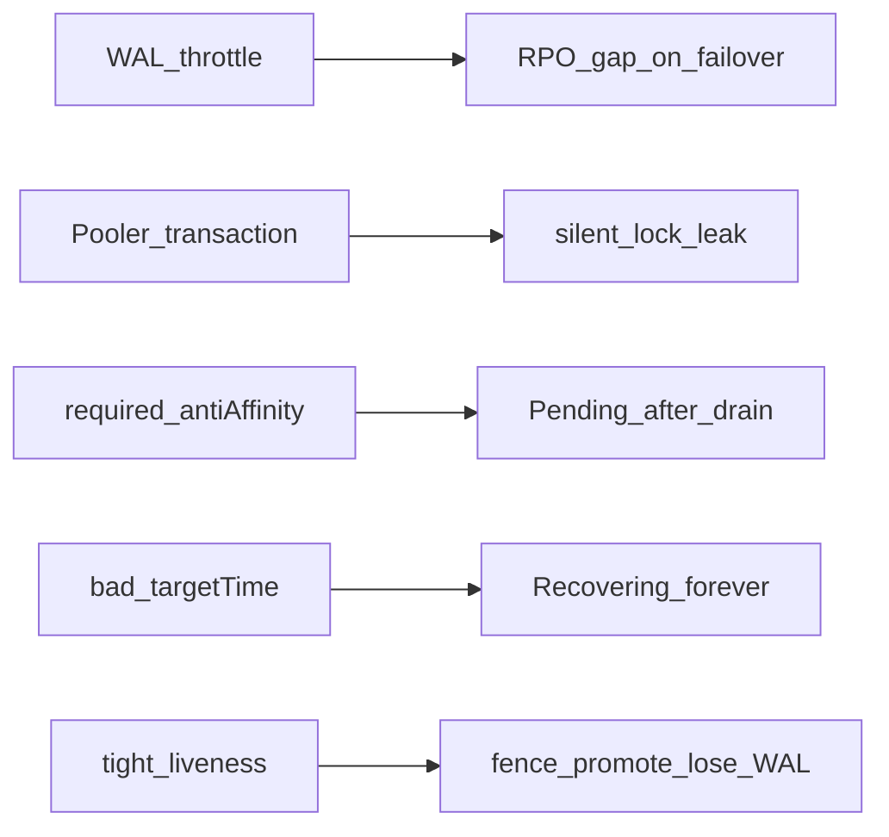

# Production Failure Patterns

Lab-Übernahme aus [CloudNativePG in production: five failure patterns](https://perun.au/insights/cloudnative-pg-production) (Perun, 2026-07-23).

SoT GitOps: dieses Repo. Ops-Runbook mit `kubectl`-Schritten: Infra_LAB Buch **K3s** → [CNPG Ops Runbook](https://github.com/HenryHST/Infra_LAB/blob/main/docs/bookstack/books/k3s/22-cnpg-ops-runbook.md). Day-2 Alerts: Infra_LAB [CNPG Day-2 Monitoring](https://github.com/HenryHST/Infra_LAB/blob/main/docs/bookstack/books/k3s/19-cnpg-day2-monitoring.md).

## Die fünf Muster

| # | Muster | Lab-Status | Übernahme |
|---|--------|------------|-----------|
| 01 | Object-Store drosselt WAL-Archive → `pg_wal` füllt PVC | Authentik: Barman Plugin → RustFS; Alerts `PGWalArchivingStalled`, `CloudNativePGWalDirectoryHigh`, `CloudNativePGWalArchiveErrors` | Alerts + Runbook; kein AWS-Rate-Limit-Thema |
| 02 | PgBouncer `poolMode: transaction` | **Kein Pooler** — Apps auf `*-rw` | Bewusst **nicht** deployen; später nur `session` nach App-Audit |
| 03 | `required` Anti-Affinity, `#nodes == instances`, nach Drain Pending | HA Authentik/Gatus: Anti-Affinity + genug Worker; Alert `CloudNativePGInstancesMissing` | Alert + Escape Hatch dokumentieren |
| 04 | `recoveryTarget.targetTime` vor ältestem Base-Backup | Authentik PITR via Plugin | Katalog prüfen **vor** Apply (Ops-Runbook) |
| 05 | Enge Liveness während langer CHECKPOINT | Authentik: `probes.liveness` + `checkpoint_completion_target: "0.9"` | Probe-/Checkpoint-Tuning auf IdP zuerst |

## Mapping zu Incidents

| Muster | Lab-Referenz |
|--------|--------------|
| 01 WAL | Authentik [2026-10-25 WAL-Disk](https://github.com/HenryHST/Infra_LAB/blob/main/docs/bookstack/books/authentik/11-incident-2026-10-25-pg-wal-disk.md), [2026-11-01 barman](https://github.com/HenryHST/Infra_LAB/blob/main/docs/bookstack/books/authentik/12-incident-2026-11-01-pg-wal-barman.md) |
| 03 Affinity / Pending | Authentik Ausfallsicherheit Drain; K3s Ops-Runbook |
| 05 Fence / RPO | WAL-Incidents + Liveness-Tuning in `apps/ops/authentik/cnpg-cluster.yaml` |

## Nicht übernehmen (jetzt)

- Flächendeckendes WAL/ObjectStore für Termix/Paperless/Gatus — Authentik bleibt PITR-Referenz; andere Cluster: VolumeSnapshot + `retentionPolicy: 7d` + `pg_dump`.
- PgBouncer/Pooler ohne Connection-Druck und ohne Session-Feature-Audit (`pg_advisory_lock`, `PREPARE`, `SET search_path`, `LISTEN`).
