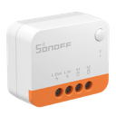
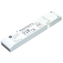
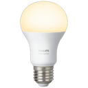
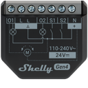
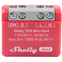
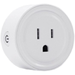
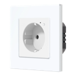
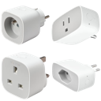

# Geräteübersicht

## Was Sie erreichen

Sie finden **pro Raum** eine eigene Seite mit den **physischen Funk-Geräten** (Zigbee, Homematic, Matter, Bluetooth) — inkl. Typ, Stromversorgung und Batterieformfaktor.

> **Stand:** 2026-10-19 · Instanz **ha02** (HST-Home). Entity-IDs und Admin-Listen: Kapitel *Systemübersicht*. Bedienung: *Zigbee*, *Homematic*, *Matter*, *Bluetooth*.

**Nicht enthalten:** Z2M-Gruppen, Bridge/Stick/OpenCCU, virtuelle Empfänger, WLAN-TVs/Echo/Kameras, **Bluetooth-Proxies** (ESP/SLZB), reine Infrastruktur.

**Hinweis Batterie/Bilder:** Formfaktoren nach typischem Modell; unsicher mit `?`. Produktbilder liegen lokal unter `media/devices/` (128px-Thumbnails) — fehlen sie, steht `—`.

## Inhaltsverzeichnis

- [Wohnzimmer](16-wohnzimmer.md)
- [Schlafzimmer](17-schlafzimmer.md)
- [Küche](18-kueche.md)
- [Eingangsflur](19-eingangsflur.md)
- [Flur](20-flur.md)
- [Badezimmer](21-badezimmer.md)
- [Gäste WC](22-gaeste-wc.md)
- [Balkon](23-balkon.md)
- [Arbeitszimmer](24-arbeitszimmer.md)
- [Serverschrank](25-serverschrank.md)

## Ohne Raum / ungeordnet

| Name | Home Assistant Name | Gerätetyp | Hersteller | Produktbild | Funkstandard | Stromversorgung | Batterie Formfaktor |
|------|------|------|------|------|------|------|------|
| AZ-Deckenlicht | AZ-Deckenlicht | Licht | SONOFF |  | Zigbee | Stromnetz | — |
| Balkonlampen | Balkonlampen | Licht | SONOFF |  | Zigbee | Stromnetz | — |
| GInfra | GInfra | Licht | SONOFF |  | Zigbee | Stromnetz | — |
| Out-Door | Out-Door | Licht | Dresden Elektronik |  | Zigbee | Stromnetz | — |
| SZ-Deckenlicht | SZ-Deckenlicht | Licht | SONOFF |  | Zigbee | Stromnetz | — |
| WZ-Shelly1 | WZ-Shelly1 | Licht | Philips |  | Zigbee | Stromnetz | — |
| Küche-RE | Küche-RE | Rollladen / Cover | Shelly |  | Zigbee | Stromnetz | — |
| WZ-Tür | WZ-Tür | Rollladen / Cover | Shelly |  | Zigbee | Stromnetz | — |
| 0x7c2c67… | 0x7c2c67fffe6e9068 | Steckdose / Plug | Shelly |  | Zigbee | Stromnetz | — |
| BP-Power | BP-Power | Steckdose / Plug | UseeLink |  | Zigbee | Stromnetz | — |
| Couch | Couch | Steckdose / Plug | BSEED |  | Zigbee | Stromnetz | — |
| Garagenlicht | Garagenlicht | Steckdose / Plug | Shelly |  | Zigbee | Stromnetz | — |
| Hifi-Power | Hifi-Power | Steckdose / Plug | UseeLink |  | Zigbee | Stromnetz | — |
| m4 | m4 | Steckdose / Plug | Shelly |  | Zigbee | Stromnetz | — |
| m5 | m5 | Steckdose / Plug | Shelly |  | Zigbee | Stromnetz | — |
| Switch3 | Switch3 | Steckdose / Plug | IKEA |  | Zigbee | Stromnetz | — |
| Tom | Tom | Steckdose / Plug | IKEA |  | Zigbee | Stromnetz | — |
| Waschmaschine | Waschmaschine | Steckdose / Plug | IKEA |  | Zigbee | Stromnetz | — |
| WZ-TV | WZ-TV | Steckdose / Plug | IKEA |  | Zigbee | Stromnetz | — |

## Kurzstatistik

| Funk | Anzahl |
|------|--------|
| Zigbee | 73 |
| Homematic | 10 |
| Matter | 9 |
| Bluetooth | 1 |
| **Summe** | **93** |

## Hilfe

- Technik & Automationen: *Zigbee*, *Homematic*, *Matter*, *Bluetooth*
- Entity-Listen: *Systemübersicht*
- Ansprechpartner: Homelab-Admin
