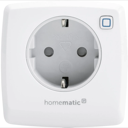

# Wohnzimmer

> Funk-Endgeräte (Zigbee / Homematic / Matter / Bluetooth) · Stand 2026-10-19 · zurück zur [*Geräteübersicht*](15-geraeteuebersicht.md)

| Name | Home Assistant Name | Gerätetyp | Hersteller | Produktbild | Funkstandard | Stromversorgung | Batterie Formfaktor |
|------|------|------|------|------|------|------|------|
| Strip-li | Strip-li | Licht | Nanoleaf |  | Matter | Stromnetz | — |
| Strip-re | Strip-re | Licht | Nanoleaf |  | Matter | Stromnetz | — |
| Strip-tv | Strip-tv | Licht | Nanoleaf |  | Matter | Stromnetz | — |
| TV Licht | TV Licht | Licht | Philips |  | Zigbee | Stromnetz | — |
| RM-WZ | RM-WZ | Rauchmelder | Aqara |  | Zigbee | Batterie | CR123A |
| Rollo-Mitte-Links | Rollo-Mitte-Links | Rollladen / Cover | eQ-3 |  | Homematic | Stromnetz | — |
| Rollo-Mitte-Rechts | Rollo-Mitte-Rechts | Rollladen / Cover | eQ-3 |  | Homematic | Stromnetz | — |
| Rollo-RE-LI | Rollo-RE-LI | Rollladen / Cover | eQ-3 |  | Homematic | Stromnetz | — |
| Rollo-RE-RE | Rollo-RE-RE | Rollladen / Cover | eQ-3 |  | Homematic | Stromnetz | — |
| AIR-WZ | AIR-WZ | Sensor Luftqualität | IKEA |  | Matter | Stromnetz | — |
| AV Verstärker | AV Verstärker | Steckdose / Plug | IKEA |  | Zigbee | Stromnetz | — |
| Fitness | Fitness | Steckdose / Plug | BSEED |  | Zigbee | Stromnetz | — |
| Plug3 | Plug3 | Steckdose / Plug | OSRAM |  | Zigbee | Stromnetz | — |
| Stern | Stern | Steckdose / Plug | NEO |  | Zigbee | Stromnetz | — |
| Sub2 | Sub2 | Steckdose / Plug | IKEA |  | Zigbee | Stromnetz | — |
| WZ-TV-Box | WZ-TV-Box | Steckdose / Plug | IKEA |  | Zigbee | Stromnetz | — |
| WZ-Rollo | WZ-Rollo | Taster / Schalter / Dimmer | — | — | Bluetooth | Batterie | CR2032 |
| WZ-TV-SW | WZ-TV-SW | Taster / Schalter / Dimmer | IKEA |  | Zigbee | Batterie | CR2032 |
| Balkon-Tür-WZ | Balkon-Tür-WZ | Tür-/Fensterkontakt | eQ-3 |  | Homematic | Batterie | AAA |
| Wassermelder WZ-Mi | Wassermelder WZ-Mi | Wassermelder | Aqara |  | Zigbee | Batterie | CR2032 |
| Wassermelder WZ-RE | Wassermelder WZ-RE | Wassermelder | Aqara |  | Zigbee | Batterie | CR2032 |
| WZL-Wasser | WZL-Wasser | Wassermelder | IKEA |  | Zigbee | Batterie | CR2032 |
| WZM-Wasser | WZM-Wasser | Wassermelder | IKEA |  | Zigbee | Batterie | CR2032 |
| WZR-Wasser | WZR-Wasser | Wassermelder | IKEA |  | Zigbee | Batterie | CR2032 |
