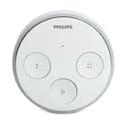
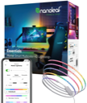
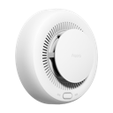
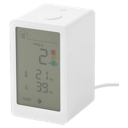
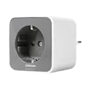
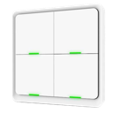

# Schlafzimmer

> Funk-Endgeräte (Zigbee / Homematic / Matter / Bluetooth) · Stand 2026-10-19 · zurück zur [*Geräteübersicht*](15-geraeteuebersicht.md)

| Name | Home Assistant Name | Gerätetyp | Hersteller | Produktbild | Funkstandard | Stromversorgung | Batterie Formfaktor |
|------|------|------|------|------|------|------|------|
| Schranklampe | Schranklampe | Licht | Philips |  | Zigbee | Stromnetz | — |
| Strip-bett | Strip-bett | Licht | Nanoleaf |  | Matter | Stromnetz | — |
| TV Schlafzimmer | TV Schlafzimmer | Licht | SONOFF |  | Zigbee | Stromnetz | — |
| RM-SZ | RM-SZ | Rauchmelder | Aqara |  | Zigbee | Batterie | CR123A |
| SZ-Fenster | SZ-Fenster | Rollladen / Cover | Shelly |  | Zigbee | Stromnetz | — |
| SZ-Tür | SZ-Tür | Rollladen / Cover | Shelly |  | Zigbee | Stromnetz | — |
| AIR-SZ | AIR-SZ | Sensor Luftqualität | IKEA |  | Matter | Stromnetz | — |
| Nachttisch | Nachttisch | Steckdose / Plug | OSRAM |  | Zigbee | Stromnetz | — |
| Schranklicht | Schranklicht | Steckdose / Plug | IKEA |  | Zigbee | Stromnetz | — |
| Dimmer Schlafzimmer | Dimmer Schlafzimmer | Taster / Schalter / Dimmer | Tuya |  | Zigbee | Batterie | CR2032 |
| Schalter-SZ | Schalter-SZ | Taster / Schalter / Dimmer | SONOFF |  | Zigbee | Batterie | CR2032 |
