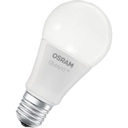
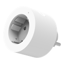
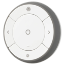
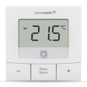

# Küche

> Funk-Endgeräte (Zigbee / Homematic / Matter / Bluetooth) · Stand 2026-10-19 · zurück zur [*Geräteübersicht*](15-geraeteuebersicht.md)

| Name | Home Assistant Name | Gerätetyp | Hersteller | Produktbild | Funkstandard | Stromversorgung | Batterie Formfaktor |
|------|------|------|------|------|------|------|------|
| Küchenlicht | Küchenlicht | Licht | OSRAM |  | Zigbee | Stromnetz | — |
| Waschbeckenlicht | Waschbeckenlicht | Licht | Dresden Elektronik |  | Zigbee | Stromnetz | — |
| Küche-LI | Küche-LI | Rollladen / Cover | Shelly |  | Zigbee | Stromnetz | — |
| Küche-Temp | Küche-Temp / Küche-Feucht | Sensor Temperatur/Feuchte | IKEA |  | Matter | Batterie | AAA |
| Jura | Jura | Steckdose / Plug | Innr |  | Zigbee | Stromnetz | — |
| Spülmaschine | Spülmaschine | Steckdose / Plug | IKEA |  | Zigbee | Stromnetz | — |
| Küche-SW | Küche-SW | Taster / Schalter / Dimmer | SONOFF |  | Zigbee | Batterie | CR2032 |
| Schalter Küche | Schalter Küche | Taster / Schalter / Dimmer | IKEA |  | Zigbee | Batterie | CR2032 |
| Kühlschrank-Thermostat | Kühlschrank | Thermostat / Wandthermostat | eQ-3 |  | Homematic | Batterie | AA |
