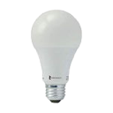
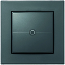

# Eingangsflur

> Funk-Endgeräte (Zigbee / Homematic / Matter / Bluetooth) · Stand 2026-10-19 · zurück zur [*Geräteübersicht*](15-geraeteuebersicht.md)

| Name | Home Assistant Name | Gerätetyp | Hersteller | Produktbild | Funkstandard | Stromversorgung | Batterie Formfaktor |
|------|------|------|------|------|------|------|------|
| Flurlampe | Flurlampe | Licht | SONOFF |  | Zigbee | Stromnetz | — |
| Job | Job | Licht | Third Reality |  | Zigbee | Stromnetz | — |
| Spot1 | Spot1 | Licht | Philips |  | Zigbee | Stromnetz | — |
| Spot2 | Spot2 | Licht | Philips |  | Zigbee | Stromnetz | — |
| Flur-Sensor | Flur | Sensor Temperatur/Feuchte | Aqara |  | Zigbee | Batterie | CR2032 |
| Flur-Temp | Flur-Temp / Flur-Feucht | Sensor Temperatur/Feuchte | IKEA |  | Matter | Batterie | AAA |
| Flurtaster | Flurtaster | Taster / Schalter / Dimmer | eQ-3 |  | Homematic | Batterie | AAA |
