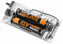

# Flur

> Funk-Endgeräte (Zigbee / Homematic / Matter / Bluetooth) · Stand 2026-10-19 · zurück zur [*Geräteübersicht*](15-geraeteuebersicht.md)

| Name | Home Assistant Name | Gerätetyp | Hersteller | Produktbild | Funkstandard | Stromversorgung | Batterie Formfaktor |
|------|------|------|------|------|------|------|------|
| Klingel | Klingel | Klingel | eQ-3 |  | Homematic | Stromnetz | — |
