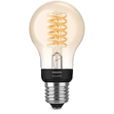

# Badezimmer

> Funk-Endgeräte (Zigbee / Homematic / Matter / Bluetooth) · Stand 2026-10-19 · zurück zur [*Geräteübersicht*](15-geraeteuebersicht.md)

| Name | Home Assistant Name | Gerätetyp | Hersteller | Produktbild | Funkstandard | Stromversorgung | Batterie Formfaktor |
|------|------|------|------|------|------|------|------|
| Mauslicht | Mauslicht | Licht | Philips |  | Zigbee | Stromnetz | — |
| BZ-Temp | BZ-Temp | Sensor Temperatur/Feuchte | SONOFF |  | Zigbee | Batterie | AAA |
| Maus Schalter | Maus Schalter | Taster / Schalter / Dimmer | Philips |  | Zigbee | Batterie | CR2032 |
| BL-Wasser | BL-Wasser | Wassermelder | IKEA |  | Zigbee | Batterie | CR2032 |
| BR-Wasser | BR-Wasser | Wassermelder | IKEA |  | Zigbee | Batterie | CR2032 |
| WM-H2O | WM-H2O | Wassermelder | IKEA |  | Zigbee | Batterie | CR2032 |
