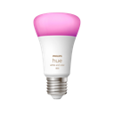
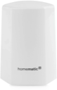

# Balkon

> Funk-Endgeräte (Zigbee / Homematic / Matter / Bluetooth) · Stand 2026-10-19 · zurück zur [*Geräteübersicht*](15-geraeteuebersicht.md)

| Name | Home Assistant Name | Gerätetyp | Hersteller | Produktbild | Funkstandard | Stromversorgung | Batterie Formfaktor |
|------|------|------|------|------|------|------|------|
| Balkonlicht03 | Balkonlicht03 | Licht | Philips |  | Zigbee | Stromnetz | — |
| Temp-Balkon | Temp-Balkon | Sensor Temperatur/Feuchte | eQ-3 |  | Homematic | Batterie | AAA |
| PV Plug | PV Plug | Steckdose / Plug | NEO |  | Zigbee | Stromnetz | — |
| Garagentor | Garagentor | Vibrationssensor | Aqara |  | Zigbee | Batterie | CR2032 |
