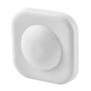
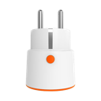
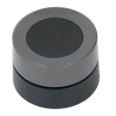
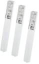
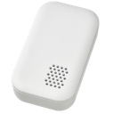

# Arbeitszimmer

> Funk-Endgeräte (Zigbee / Homematic / Matter / Bluetooth) · Stand 2026-10-19 · zurück zur [*Geräteübersicht*](15-geraeteuebersicht.md)

| Name | Home Assistant Name | Gerätetyp | Hersteller | Produktbild | Funkstandard | Stromversorgung | Batterie Formfaktor |
|------|------|------|------|------|------|------|------|
| AZ-Temp | AZ-Temp / AZ-Feucht | Sensor Temperatur/Feuchte | IKEA |  | Matter | Batterie | AAA |
| Modem | Modem | Steckdose / Plug | NEO |  | Zigbee | Stromnetz | — |
| Monitor Arbeit | Monitor Arbeit | Steckdose / Plug | IKEA |  | Zigbee | Stromnetz | — |
| Monitor Privat | Monitor Privat | Steckdose / Plug | IKEA |  | Zigbee | Stromnetz | — |
| Schreibtisch Marion | Schreibtisch Marion | Steckdose / Plug | IKEA |  | Zigbee | Stromnetz | — |
| Drehknopf | Drehknopf | Taster / Schalter / Dimmer | Tuya |  | Zigbee | Batterie | CR2032 |
| Schalter AZ | Schalter AZ | Taster / Schalter / Dimmer | Philips |  | Zigbee | Batterie | AAA |
| AZ-Fenster-klein | AZ-Fenster-klein | Tür-/Fensterkontakt | eQ-3 |  | Homematic | Batterie | AAA |
| AZL-Wasser | AZL-Wasser | Wassermelder | IKEA |  | Zigbee | Batterie | CR2032 |
