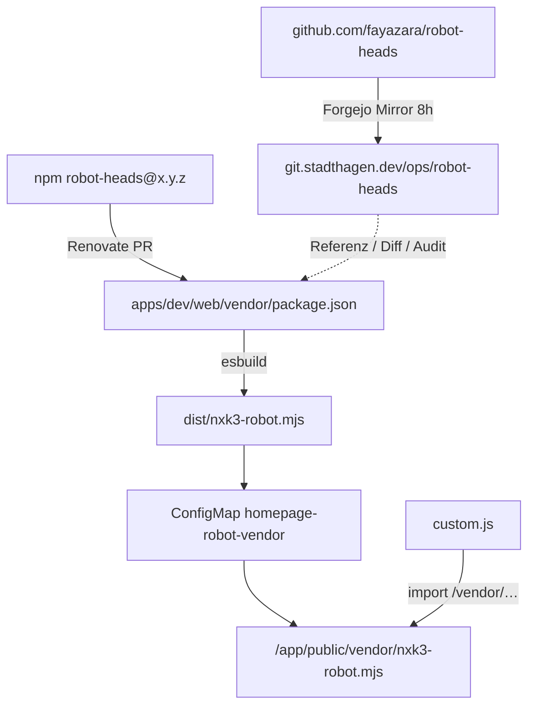

# Homepage: Robot-Heads Mascot

> **Buch** v1.4.0 · Stand: 2026-10-31

Auf [web.stadthagen.dev](https://web.stadthagen.dev) (gethomepage) sitzt unten rechts ein animierter **robot-heads**-Kopf. Der State folgt der Cluster-Gesundheit (Node `Ready`).

Library: [fayazara/robot-heads](https://github.com/fayazara/robot-heads) (npm `robot-heads`, MIT) — React-Canvas, kein WebGL.

## Überblick

| | |
|--|--|
| Host | `https://web.stadthagen.dev` |
| App-Pfad | `apps/dev/web/` |
| Namespace | `homepage` |
| Integration | `config/custom.js` + `config/custom.css` (ConfigMap `homepage-config`) |
| Vendor-Bundle | ConfigMap `homepage-robot-vendor` → `/vendor/nxk3-robot.mjs` |
| Upstream-Mirror | `https://git.stadthagen.dev/ops/robot-heads` (Forgejo Mirror, Intervall **8h**) |
| Platzierung | fixed unten rechts (`.nxk3-robot-mascot`) |
| Props | `shape="circle"`, `antenna: true`, `interactive: true`, `speed: 1`, `size: 100` |



## State-Mapping

Datenquelle: same-origin Homepage-API **`/api/widgets/kubernetes?lang=de`** (bereits RBAC + Widget; Response enthält pro Node `ready`).

| Cluster-Lage | Robot `state` |
|--------------|---------------|
| Alle Nodes `ready === true` | `happy` |
| Mindestens ein Node not ready | `thinking` |
| Kein Node ready **oder** API-Fehler | `error` |

Poll alle **10 s**; bei Tab `visibilityState === hidden` pausiert der Poll. Tooltip/`title` z. B. `nXk3: 13/13 Ready` bzw. NotReady-Namen.

## Dateien (Git)

| Datei | Rolle |
|-------|--------|
| [`apps/dev/web/config/custom.js`](../../../../apps/dev/web/config/custom.js) | Auth-Badges + Robot-Mount (lokales ESM) |
| [`apps/dev/web/config/custom.css`](../../../../apps/dev/web/config/custom.css) | `.nxk3-robot-mascot` fixed corner |
| [`apps/dev/web/configmap.yaml`](../../../../apps/dev/web/configmap.yaml) | Argo-SoT — **muss** mit `config/*` synchron bleiben |
| [`apps/dev/web/vendor/`](../../../../apps/dev/web/vendor/) | npm pins + esbuild → `dist/nxk3-robot.mjs` |
| [`apps/dev/web/homepage-robot-vendor.configmap.yaml`](../../../../apps/dev/web/homepage-robot-vendor.configmap.yaml) | Dist als ConfigMap (generiert via `npm run sync-configmap`; Argo **ServerSideApply** wegen Größe) |
| [`apps/dev/web/deployment.yaml`](../../../../apps/dev/web/deployment.yaml) | Mount `/app/public/vendor` |

Homepage liefert Custom-Assets unter `/api/config/custom.js` und `/api/config/custom.css`. Das Bundle liegt unter **`/vendor/nxk3-robot.mjs`** (same-origin, kein CDN).

## Lokal statt esm.sh

`custom.js` hängt ein `type="module"`-Script an, das nur noch importiert:

```js
import { React, useEffect, useState, createRoot, RobotHead } from "/vendor/nxk3-robot.mjs";
```

Build (Pin-Quelle = npm; Mirror = Git-Audit):

```bash
cd apps/dev/web/vendor
npm install
npm run build              # → dist/nxk3-robot.mjs
npm run sync-configmap     # → homepage-robot-vendor.configmap.yaml
```

## Forgejo-Mirror

| Feld | Wert |
|------|------|
| Upstream | `https://github.com/fayazara/robot-heads.git` |
| Lab | `https://git.stadthagen.dev/ops/robot-heads` |
| Mirror | ja, Intervall **8h** |
| IaC | OpenTofu [`terraform/forgejo`](https://github.com/HenryHST/Infra_LAB/tree/main/terraform/forgejo) — `forgejo_repository.this["robot_heads"]` (`clone_addr` + `mirror`); Adopt importiert vorhandenes Repo |
| Zweck | Tags/Commits im Lab zum Lesen/Diffen/Audit — **kein** npm-Ersatz |

Neuinstallation: `./scripts/reconcile.sh dev` (bzw. Ansible `--tags forgejo-bootstrap`) legt den Mirror an bzw. importiert ihn. Org `ops` ist privat → Repo ist **internal** (Auth nötig für Anon-HTTP); authentifizierter `git ls-remote` zeigt Tags inkl. `v0.3.0`.

## Renovate

In [`renovate.json`](../../../../renovate.json): Gruppe **`homepage-robot-vendor`** für `robot-heads`, `react`, `react-dom` auf `apps/dev/web/vendor/package.json`.

Nach Merge eines Version-Bumps:

1. `cd apps/dev/web/vendor && npm install && npm run build && npm run sync-configmap`
2. Dist + ConfigMap committen
3. Homepage rollen / Argo sync

Der Mirror allein aktualisiert **nicht** das laufende Bundle.

## Deploy / Reload

```bash
kubectl apply -f apps/dev/web/homepage-robot-vendor.configmap.yaml
kubectl apply -f apps/dev/web/configmap.yaml
kubectl apply -f apps/dev/web/deployment.yaml
kubectl -n homepage rollout restart deploy/web
```

Argo CD AppSet `dev` → Pfad `apps/dev/web` synct dasselbe. Browser: hart neu laden (Cache von `custom.js`).

## Verifikation

```bash
curl -sk https://web.stadthagen.dev/vendor/nxk3-robot.mjs | head -c 80
curl -sk https://web.stadthagen.dev/api/config/custom.js | grep -E 'vendor/nxk3-robot|antenna|speed'
# Mirror (auth): Tags inkl. v0.3.0
# Renovate: packageRules groupName homepage-robot-vendor
curl -sk https://web.stadthagen.dev/api/widgets/kubernetes?lang=de | \
  jq '{nodes: (.nodes|length), ready: ([.nodes[]|select(.ready)]|length)}'
```

Im Browser: Element `#nxk3-robot-root` mit Canvas; Network-Tab ohne `esm.sh`; `title` z. B. `nXk3: 13/13 Ready`.

## Warum Vendor-ConfigMap statt Image-Build?

gethomepage läuft als fertiges Image (`ghcr.io/gethomepage/homepage`). Custom-JS/CSS bleibt der Erweiterungspunkt; React + robot-heads werden als **committetes** Browser-ESM unter `/vendor/` gemountet — offline-fähig zur Laufzeit.
