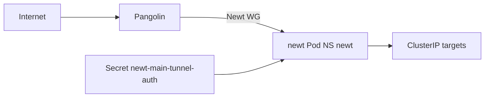

# Übersicht

> **Buch** v1.0.0 · **Kapitel** v1.0.0 · Stand: 2026-10-28

**Newt** ist der Pangolin-Site-Agent im Cluster: WireGuard-Tunnel von Pangolin (`pangolin.stadthagen.dev`) zu ClusterIP-Services hinter dem Site-Namen `k3s` (z. B. `*-ext` Publish).

| | |
|--|--|
| Argo App | `newt` (ApplicationSet **ops**, Sync-Wave **0**) |
| Namespace | `newt` |
| Chart | `fossorial/newt` **1.5.0** (`https://charts.fossorial.io`) |
| Values | [`apps/ops/newt/values.yaml`](../../../../apps/ops/newt/values.yaml) |
| Image | `docker.io/fosrl/newt:1.19.1` (Tag vor Chart-appVersion gepinnt) |
| Secret | `newt-main-tunnel-auth` — SecretSpec via Infra_LAB (`NEWT_*` / Endpoint) |
| Docs-Link (Argo) | dieses Buch unter `docs/bookstack/books/newt` |

Verwandt: Infra_LAB Pangolin-Stack / Publish (`pangolin-publish`), Buch **Authentik** Pangolin-Kapitel wo relevant.
