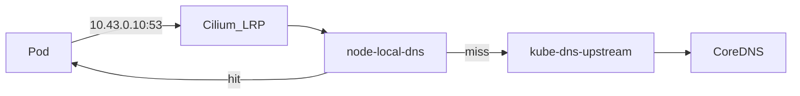

# Übersicht

NodeLocal DNSCache läuft als DaemonSet in `kube-system` und cached DNS **pro Node**. Unter nXk3 (Cilium **ohne** kube-proxy) steuert eine **CiliumLocalRedirectPolicy** Traffic zum ClusterDNS (`kube-dns` / `10.43.0.10`) auf den lokalen Cache um.



| | |
|--|--|
| Argo App | `node-local-dns` (ApplicationSet `ops`, Wave 1) |
| Manifests | [`apps/ops/node-local-dns/`](../../../../apps/ops/node-local-dns/) |
| Cilium Voraussetzung | `localRedirectPolicy: true` (Infra_LAB Ansible `cni_cilium`) |
| Pod resolv.conf | unverändert `nameserver 10.43.0.10` |

**Nicht** der Medium-/iptables-Pfad mit `hostNetwork` und Dummy-IF — der greift bei Cilium kube-proxy replacement nicht. Medium = Konzept; Umsetzung hier = **Cilium LRP**.

## Nutzen

- Niedrigere DNS-Latenz bei Cache-Hits
- Weniger QPS / CPU auf CoreDNS
- Weniger Overlay-Traffic für wiederholte Lookups
- Puffer bei DNS-Stürmen (Rollouts, Node-Reboots)

## NetworkPolicies

Egress-Regeln müssen `k8s-app` in `{kube-dns, node-local-dns}` erlauben (siehe Template `apps/_templates/networkpolicy-app.yaml`). Nur `kube-dns` reicht nach LRP nicht.

## Verify

Siehe App-README: [`apps/ops/node-local-dns/README.md`](../../../../apps/ops/node-local-dns/README.md).

Kurz:

```bash
kubectl -n kube-system get pods -l k8s-app=node-local-dns
kubectl -n kube-system exec -it ds/cilium -- cilium-dbg config get EnableLocalRedirectPolicy
kubectl -n kube-system exec -it ds/cilium -- cilium-dbg lrp list
```

Cluster-Check 2026-10-29: LRP aktiv (`10.43.0.10:53` → LocalRedirect), Cache-Metrics auf `:9253`, App-Smoke BookStack/Vaultwarden OK. Ein Node (`pi2cl` NotReady) hält DaemonSet bei 12/13 — Node-Thema, siehe Infra_LAB [`node-stability.md`](https://github.com/HenryHST/Infra_LAB/blob/main/ansible/playbooks/k3s_cluster/docs/node-stability.md).

## Quellen

- Cilium: [Local Redirect Policy — Node-local DNS](https://docs.cilium.io/en/stable/network/kubernetes/local-redirect-policy/#node-local-dns-cache)
- Kubernetes: [NodeLocal DNSCache](https://kubernetes.io/docs/tasks/administer-cluster/nodelocaldns/)
- Infra_LAB Day-2: Cilium `localRedirectPolicies.enabled` + Querverweis in Buch **K3s**