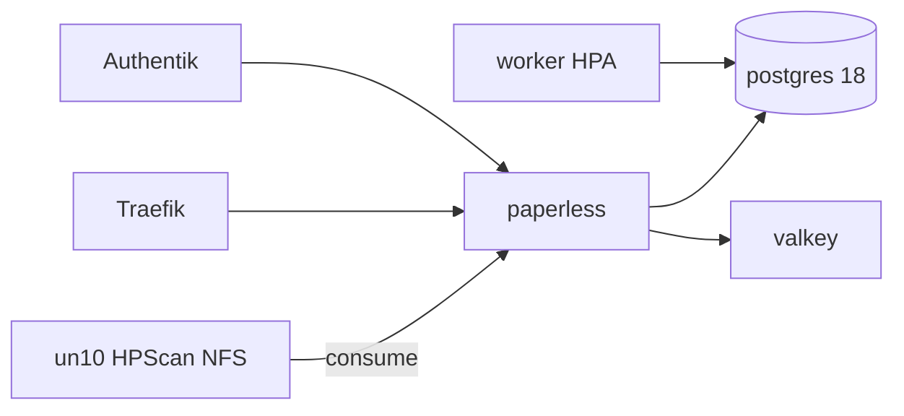

# Übersicht

> **Buch** v1.10.0 · Stand: 2026-10-26

Paperless-ngx archiviert Dokumente mit OCR (Deutsch + Englisch), importiert Scans vom HPScan-NFS und meldet sich per Authentik an.

| | |
|--|--|
| Argo App | `paperless` (ApplicationSet `dev`, Wave 3) |
| Namespace | `paperless` |
| Valkey | `apps/infra/redis` (Wave 1, `valkey/valkey:9.1.2-alpine`, Redis-Protokoll, **emptyDir**) |
| LAN | https://paperless.stadthagen.dev |
| Ext | https://paperless-ext.stadthagen.dev (**disabled** in pangolin-publish) |
| **Storage** | **Postgres:** CNPG `paperless-pg` auf Longhorn. **App-Daten:** lokale Volumes (`local` PVs, StorageClass `manual-paperless`) auf Worker **`nxk3-w01`** — `/var/lib/paperless-data`, `/var/lib/paperless-media`, `/var/lib/paperless-export`. **Consume:** NFS HPScan. **Backups (Strategie C):** `document_exporter` ZIP → NFS `…/infra01/paperless-backups` + CNPG VolumeSnapshots — Kapitel **Backup & Restore**. |

Web- und Worker-Pods sind an `nxk3-w01` gebunden (Node-Affinity / hostPath). Ohne die drei Verzeichnisse auf dem Node starten sie nicht (`FailedMount`). Details und Anlage: Kapitel **Deploy & Verify** (Local Storage / Troubleshooting). Begründung: [ADR-0026](../../../adr/0026-paperless-ngx.md).

OIDC-Zugang und Dokumentgruppen (Familien / vs-nfd): Kapitel **OIDC-Gruppen**.

Media-Dateinamen folgen `{{created_year}}_{{correspondent}}_{{title}}` (`PAPERLESS_FILENAME_FORMAT` in Web- und Worker-Deployment). Nach Format-Wechsel bestehende Dateien per `document_renamer` umbenennen — Details: Kapitel **Deploy & Verify**.

Image-Pins und Trivy-Residuals (Gotenberg/Paperless Upstream, `k8s-toolbox:1.0.1`): Kapitel **Trivy & CVE-Hygiene**.

Backup/Restore (Exporter-ZIP, Restore-Gate, Verifikation V1–V14): Kapitel **Backup & Restore**.

Cutover Redis→Valkey 9.1 (RWO FailedAttach + RDB v15) und Appendix 2026-10-28 (Terminating PVC → ephemeral): Kapitel **Incident 2026-10-26 Redis→Valkey**.

OCR Deskew/Rotate sowie Seed von Dokumententypen, Tags und Workflow **Kategorie hinzufügen**: Kapitel **Deploy & Verify**.
