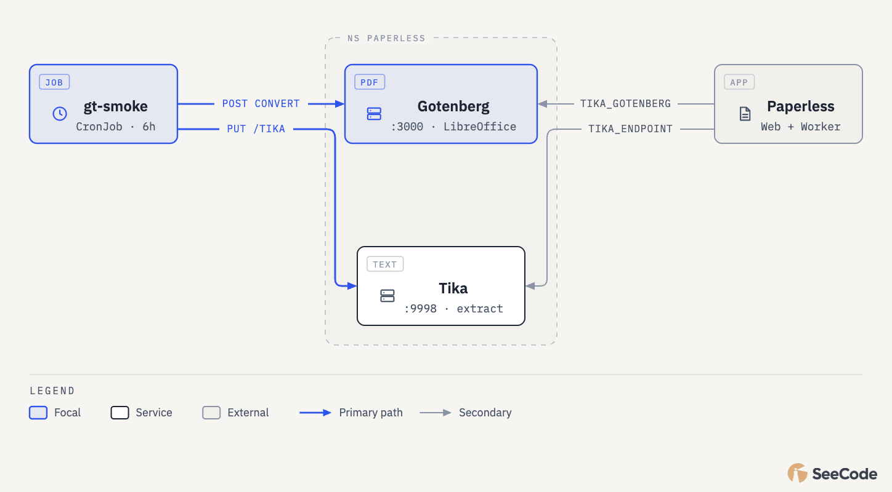
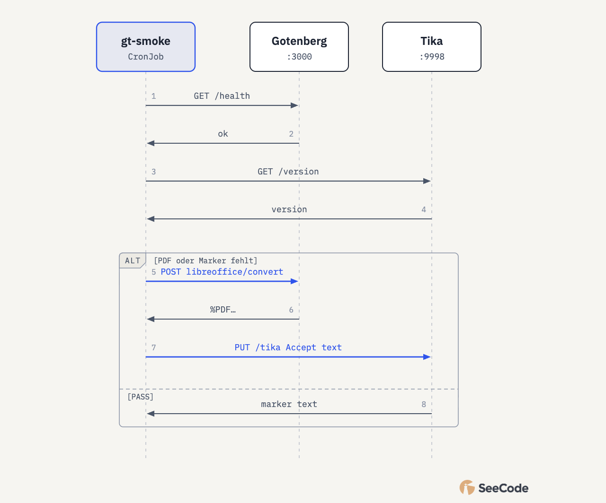

# Gotenberg & Tika Smoke

> **Buch** v1.5.0 · **Kapitel** v1.2.0 · Stand: 2026-10-23

Funktionaler Smoke für die Office→PDF→Text-Kette plus bewerteter Paperless-Systemstatus (inkl. Backups). Der PDF-Bericht zeigt zwei Verdict-Karten — auf einen Blick: Smoke erfolgreich? System okay?

## Überblick

| Element | Wert |
|---------|------|
| CronJob | `paperless-gt-smoke` (NS `paperless`) |
| Schedule | `0 */6 * * *` (UTC), Forbid |
| ServiceAccount | `paperless-gt-smoke` (get/list Pods, Deploy, HPA, PVC, CronJob/Job, CNPG Cluster/Backup/ScheduledBackup) |
| Image | `git.stadthagen.dev/ops/k8s-toolbox:1.0.0` (amd64 `nodeSelector`) |
| Gotenberg | LibreOffice convert + Chromium HTML→PDF |
| Manifest | minilab `apps/dev/paperless/gotenberg-tika-smoke.yaml` |
| Report-Mail | An `paperless@stadthagen.dev`; From/SMTP `auto@henrystadthagen.de` |
| Betreff | `[paperless-gt-smoke] SMOKE=PASS SYS=OK` (bzw. FAIL/DEGRADED; optional `[FAIL-PDF]`) |
| Anhang | PDF mit Verdict-Karten + Checklisten |

Job-Exit: nur Smoke FAIL → Job Failed. System DEGRADED/FAIL erscheint im Bericht, killt den Job nicht.



Interaktiv: [`paperless-gt-smoke.html`](../../../diagrams/seecode/paperless-gt-smoke.html)

## Verdicts

| Karte | Werte | Bedeutung |
|-------|--------|-----------|
| **Smoke** | PASS / FAIL | LibreOffice→PDF→Tika-Marker |
| **System** | OK / DEGRADED / FAIL | Ampel über Deployments, CNPG, PVC, Health, Backups |

### System FAIL (Auszug)

- Deployment mit 0 ready/available; CNPG nicht healthy; PVC nicht Bound
- Health Gotenberg/Tika ≠ 200 bzw. Paperless nicht 2xx/3xx
- Letzter App-Backup-Job `Failed`; letzter CNPG-`Backup` phase `failed`

### System DEGRADED (Auszug)

- Deployment ready &lt; desired (HPA-Scale / Rolling)
- CrashLoop/ImagePull an App-Pods; CronJob suspended
- App-Backup (`paperless-backup-cron`): kein Erfolg in **36h**
- CNPG-Snapshot (`paperless-pg-snapshot`): kein completed Backup in **12h** / ScheduledBackup fehlt

## Ablauf

1. Smoke: Health → DOCX-Fixture → LibreOffice-PDF → Tika-Marker
2. Status sammeln (kubectl JSON + Health-URLs)
3. Bewertung → HTML mit Karten/Tabellen → Chromium-PDF → Mail



Interaktiv: [`paperless-gt-smoke-flow.html`](../../../diagrams/seecode/paperless-gt-smoke-flow.html)

## Nach Image-Bump

```bash
kubectl apply -f apps/dev/paperless/gotenberg-tika-smoke.yaml
kubectl -n paperless create job --from=cronjob/paperless-gt-smoke "paperless-gt-smoke-manual-$(date +%s)"
kubectl -n paperless logs -f job/paperless-gt-smoke-manual-…
# Erwartung: verdict SMOKE=PASS SYS=…; PDF generated; mail sent … SMOKE=… SYS=…
```

## Siehe auch

- App-README: `apps/dev/paperless/README.md` (Verify)
- Deploy & Verify: [02-deploy-verify.md](02-deploy-verify.md)
- ADR-0026 Paperless-ngx
