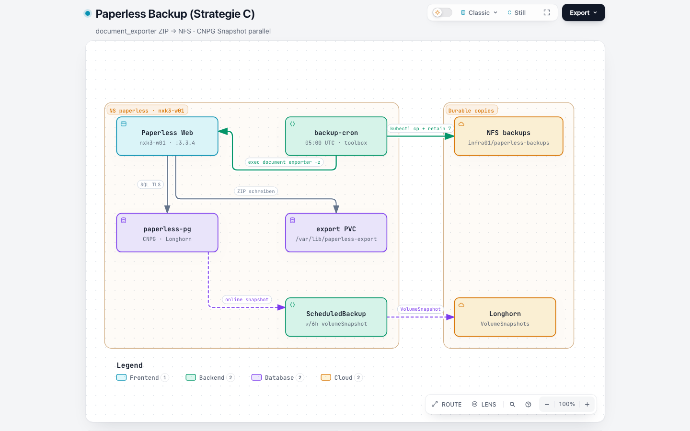
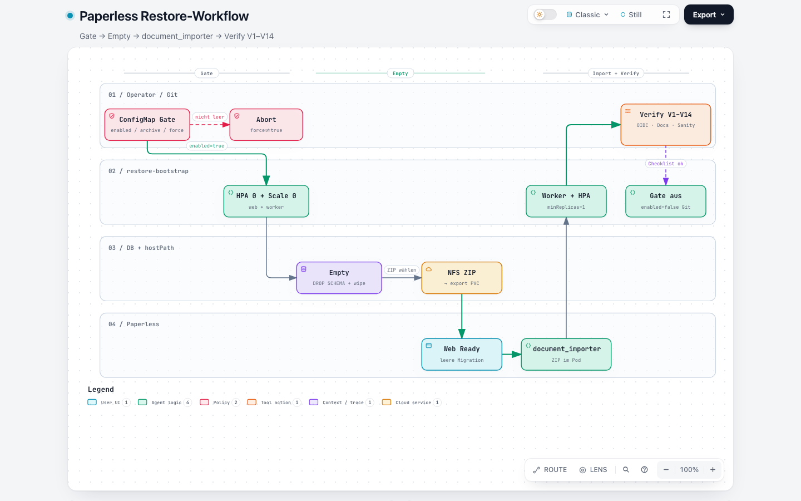

# Backup & Restore

> **Buch** v1.9.0 · **Kapitel** v1.0.0 · Stand: 2026-10-25

**Strategie C (hybrid):** Kanonisches Disaster-Recovery über Paperless `document_exporter` / `document_importer` (ZIP auf NFS). Parallel sichert CNPG `paperless-pg-snapshot` die Postgres-VolumeSnapshots (Longhorn) — **kein** Ersatz für Full-DR (Media/Metadaten).



Interaktiv: [`paperless-backup.html`](https://github.com/HenryHST/minilab/blob/main/docs/diagrams/archify/paperless-backup.html)



Interaktiv: [`paperless-restore-workflow.html`](https://github.com/HenryHST/minilab/blob/main/docs/diagrams/archify/paperless-restore-workflow.html)

Infra_LAB-Querverweis (hostPath-Prereq): Buch **Infra_LAB** → Kapitel **Paperless Backup & Restore**.

---

## 1. Überblick der Ebenen

| Ebene | Ressource | Inhalt | Ziel | RPO / Zweck |
|-------|-----------|--------|------|-------------|
| **App-Exporter** | CronJob `paperless-backup-cron` | `document_exporter -z` → ZIP (Docs, Thumbnails, Manifest/DB-Inhalt) | NFS `192.168.0.25:/var/nfs/shared/infra01/paperless-backups` | ~24 h — Full-DR / Migration |
| **CNPG Snapshot** | `ScheduledBackup paperless-pg-snapshot` | Longhorn VolumeSnapshot (online) | Cluster-Storage | ~6 h — schneller **DB-only**-Rollback |

| | |
|--|--|
| Schedule Exporter | `0 5 * * *` UTC (≈ 06:00/07:00 CE(S)T) |
| Retention NFS | letzte **7** `paperless-*.zip` (+ `.meta`) |
| PVC Backup | `paperless-backups` (PV `paperless-backups-nfs`, NFSv3 + nolock) |
| Export-Arbeitsfläche | PVC `paperless-export` → `/usr/src/paperless/export` (hostPath `/var/lib/paperless-export`) |
| Image-Pin | `ghcr.io/paperless-ngx/paperless-ngx:3.3.4` — **Export und Import gleiche Version** |
| Helper | `git.stadthagen.dev/ops/k8s-toolbox:1.0.1` |
| Restore-Gate | ConfigMap `paperless-restore` (`enabled` / `archive` / `force` / `replicas`) |
| Manifeste | `apps/dev/paperless/backup-cronjob.yaml`, `restore-bootstrap.yaml`, `scheduled-backup.yaml` |

**Nicht im ZIP:** API-Tokens (nach Import neu erzeugen), Redis-Inhalt, HPScan-Consume-Inbox, Secrets (`paperless-db` / OAuth bleiben SecretSpec).

**Upstream:** [Making backups](https://docs.paperless-ngx.com/administration/#backup) · [Exporter](https://docs.paperless-ngx.com/administration/#exporter) · [Importer](https://docs.paperless-ngx.com/administration/#importer).

---

## 2. Backup — Step-by-Step

### 2.1 Voraussetzungen

1. NFS-Verzeichnis `…/infra01/paperless-backups` existiert und ist im Cluster als PVC `paperless-backups` Bound.
2. Deployment `paperless` hat mindestens einen **Running**-Pod (`app=paperless`).
3. CronJob `paperless-backup-cron` ist deployed (Argo App `paperless` Synced).
4. Image-Pin bekannt (aktuell `3.3.4`) — steht nach dem Lauf auch in `paperless-*.meta`.

### 2.2 Automatik prüfen

```bash
kubectl -n paperless get cronjob paperless-backup-cron
kubectl -n paperless get jobs -l job-name --sort-by=.metadata.creationTimestamp | rg paperless-backup || \
  kubectl -n paperless get jobs | rg paperless-backup
kubectl -n paperless get pvc paperless-backups
```

Erwartung: CronJob vorhanden, Schedule `0 5 * * *`, letzte Jobs `Complete` (nicht `Failed`).

Optional NFS-Inhalt (von einem Job-Pod oder Node mit Mount):

```bash
# Nach manuellem Job (siehe 2.3) in den Logs prüfen, oder:
kubectl -n paperless create job --from=cronjob/paperless-backup-cron \
  paperless-backup-ls-$(date +%s) --dry-run=client -o yaml | head
```

### 2.3 Manuelles Backup auslösen

**Argo CD:** Application `paperless` → Ressource `CronJob/paperless-backup-cron` → Actions → **Create Job**.

**CLI:**

```bash
JOB="paperless-backup-manual-$(date +%s)"
kubectl -n paperless create job --from=cronjob/paperless-backup-cron "${JOB}"
kubectl -n paperless logs -f "job/${JOB}"
```

### 2.4 Was der Job tut (Erfolgskriterien)

1. Running Web-Pod wählen (`app=paperless`, Phase Running).
2. Image-Tag des Containers `paperless` lesen.
3. `document_exporter /usr/src/paperless/export -z -zn paperless-<UTC-STAMP> --no-progress-bar` im Web-Pod.
4. ZIP per `kubectl cp` nach `/backup/paperless-<STAMP>.zip` (NFS).
5. Sidecar `paperless-<STAMP>.meta` mit `image=…`, `stamp`, `tool=document_exporter`.
6. ZIP im Export-PVC wieder löschen (Platz).
7. Retention: ältere als die 7 neuesten `paperless-*.zip` (+ `.meta`) entfernen; Legacy `*.tar.gz` aufräumen.

**Erfolg in den Logs:** Zeile `Done.`, `ls -lh` zeigt ZIP + `.meta`, keine Fehler von `document_exporter` / `kubectl cp`.

### 2.5 Consume während des Backups

Exporter läuft online. Idealerweise keine großen Consume-/IMAP-Wellen parallel (weniger Drift zwischen Manifest und Dateien). Kein automatisches Scale-to-0 beim Backup.

---

## 3. Restore — Step-by-Step (Full-DR aus ZIP)

Destruktiv: überschreibt DB und `data`/`media` bei `force=true`. Nur im Wartungsfenster.


### 3.1 Vorbereitung

1. Stakeholder informieren; HPScan/IMAP-Testmails pausieren.
2. Aktuelles Image prüfen:

```bash
kubectl -n paperless get deploy paperless \
  -o jsonpath='{.spec.template.spec.containers[?(@.name=="paperless")].image}{"\n"}'
```

3. Archiv auf NFS wählen (oder `latest`). `.meta` lesen — `image=` muss zum laufenden Deployment passen (sonst zuerst Image-Pin angleichen / Archiv einer passenden Version wählen).

4. Optional: Dokumentenzahl / Stichproben-IDs notieren (für Verifikation V5/V6).

### 3.2 Gate setzen

ConfigMap `paperless-restore` (Git oder Live-Patch — Live nur für Drill, danach Git wieder `enabled=false`):

| Key | Wert |
|-----|------|
| `enabled` | `true` |
| `archive` | `latest` oder exakter ZIP-Name z. B. `paperless-20261025-050001.zip` |
| `force` | `true` wenn Instanz nicht leer |
| `replicas` | `1` (Web nach Restore) |

Beispiel Live-Patch (Drill):

```bash
kubectl -n paperless patch cm paperless-restore --type merge -p \
  '{"data":{"enabled":"true","archive":"latest","force":"true","replicas":"1"}}'
```

### 3.3 Restore-Job starten

Argo Sync der App `paperless` (PostSync Job `paperless-restore-bootstrap`) **oder** Job manuell neu anlegen, falls Hook bereits gelaufen ist:

```bash
kubectl -n paperless delete job paperless-restore-bootstrap --ignore-not-found
# dann Argo Sync, oder Job aus Manifest anwenden
kubectl -n paperless logs -f job/paperless-restore-bootstrap
```

### 3.4 Was der Job tut

1. HPA `paperless-worker` → `minReplicas=0` (sonst kämpft HPA gegen Scale-0).
2. Deployments `paperless` + `paperless-worker` → 0; warten bis Pods weg (RWO frei).
3. Ohne `force` und nicht-leerer DB → Abort + Scale-up.
4. Mit `force`: Postgres `public`-Schema droppen/neu anlegen; hostPath `data`/`media` leeren (Job auf `nxk3-w01`).
5. Web → 1; leere App startet (Migrationen).
6. ZIP von NFS nach Export-Pfad; `document_importer … --no-progress-bar`.
7. Worker + HPA wiederherstellen.
8. Log-Hinweis: **sofort** `enabled=false` in Git committen.

```bash
kubectl -n paperless patch cm paperless-restore --type merge -p \
  '{"data":{"enabled":"false","force":"false"}}'
# + gleicher Stand in Git pushen
```

### 3.5 Fallback (manuell, wenn Job fehlschlägt)

Nur wenn der PostSync-Job nicht durchläuft — gleiche Reihenfolge wie 3.4, Befehle einzeln:

```bash
# 1) HPA + Scale-0
kubectl -n paperless patch hpa paperless-worker --type merge -p '{"spec":{"minReplicas":0}}'
kubectl -n paperless scale deploy/paperless deploy/paperless-worker --replicas=0

# 2) DB leeren (Beispiel; Passwort aus Secret paperless-db)
# … pg_isready / DROP SCHEMA public CASCADE; CREATE SCHEMA … GRANT an paperless

# 3) data/media auf nxk3-w01 leeren (Wartungsfenster), dann:
kubectl -n paperless scale deploy/paperless --replicas=1
kubectl -n paperless rollout status deploy/paperless --timeout=300s

# 4) ZIP nach Export, dann:
WEB="$(kubectl -n paperless get pod -l app=paperless --field-selector=status.phase=Running \
  -o jsonpath='{.items[0].metadata.name}')"
kubectl -n paperless exec "${WEB}" -c paperless -- \
  document_importer /usr/src/paperless/export/<ARCHIV>.zip --no-progress-bar

# 5) Worker + HPA
kubectl -n paperless patch hpa paperless-worker --type merge -p '{"spec":{"minReplicas":1}}'
kubectl -n paperless scale deploy/paperless-worker --replicas=1
```

Anschließend **immer** Abschnitt 4 (Restore-Verifikation).

---

## 4. Restore-Verifikation (Pflicht)

Nach jedem Full-DR alle Punkte abhaken. Drill-Empfehlung: **quartalsweise**.

| # | Check | Erwartung | Wie |
|---|--------|-----------|-----|
| **V1** | Pods Ready | `paperless` + `paperless-worker` Running auf `nxk3-w01` | `kubectl -n paperless get pods -o wide` |
| **V2** | CNPG healthy | Cluster `paperless-pg` healthy | `kubectl -n paperless get cluster paperless-pg` |
| **V3** | App erreichbar | LAN-UI lädt / HTTP ok | Browser `https://paperless.stadthagen.dev` |
| **V4** | OIDC Login | Authentik-Login; Admin- und User-Gruppen greifen | UI-Login |
| **V5** | Dokumentenzahl | grob wie vor Restore (notierte Zahl) | UI Documents / Dashboard |
| **V6** | Stichproben | 2–3 bekannte Docs: Original + Archiv/OCR, Tags, Korrespondent | UI öffnen/Download |
| **V7** | Filename-Format | Pfade folgen `Jahr_Korrespondent_Titel` (soweit Metadaten gesetzt) | UI / Media |
| **V8** | Sanity Checker | keine kritischen Missing-Files | siehe Befehl unten |
| **V9** | Suche | Stichproben-Titel findbar | UI Suche |
| **V10** | API-Token | neuer Token funktioniert (Exporter enthält keine Tokens) | UI Profile → Auth tokens; ggf. Secret `paperless-gt-smoke` |
| **V11** | Consume | Test-Scan HPScan → Dokument mit Tag `inbox` | HPScan + UI |
| **V12** | IMAP (optional) | Test-PDF an `paperless@…` erscheint | Settings → Mail |
| **V13** | Backup-Cron | manueller Job `Complete`, neues ZIP auf NFS | `kubectl create job --from=cronjob/…` + Logs |
| **V14** | Gate aus | `enabled=false` in Cluster **und** Git | `kubectl -n paperless get cm paperless-restore -o yaml` |

**V8 Sanity Checker:**

```bash
WEB="$(kubectl -n paperless get pod -l app=paperless --field-selector=status.phase=Running \
  -o jsonpath='{.items[0].metadata.name}')"
kubectl -n paperless exec "${WEB}" -c paperless -- \
  python3 manage.py document_sanity_checker
```

**V10 Token für Smoke (falls genutzt):**

```bash
# Nach neuem Token in der UI:
kubectl -n paperless create secret generic paperless-gt-smoke \
  --from-literal=api-token='<NEU>' --dry-run=client -o yaml | kubectl apply -f -
kubectl -n paperless create job --from=cronjob/paperless-gt-smoke \
  paperless-gt-smoke-post-restore-$(date +%s)
```

Ergebnis des Drills kurz im Changelog / Ticket festhalten (Datum, Archiv-Name, V1–V14 ok/fail).

---

## 5. CNPG-Snapshot (Kurz)

```bash
kubectl -n paperless get scheduledbackup paperless-pg-snapshot
kubectl -n paperless get backup -l cnpg.io/cluster=paperless-pg
```

- Alle **6 Stunden**, Methode `volumeSnapshot`, online.
- Sinnvoll bei DB-Korruption **wenn** Media/App-Daten auf hostPath noch konsistent sind.
- Stellt **keine** Dokumentdateien und kein Exporter-Manifest wieder her → Full-DR immer über ZIP + Importer (Abschnitte 3–4).

---

## 6. Troubleshooting

| Symptom | Ursache | Maßnahme |
|---------|---------|----------|
| Backup: kein Running-Pod | Redis/Web down | Redis + `paperless` prüfen; Job erneut |
| Exporter / Disk voll | Export-PVC voll | PVC/hostPath Größe; alte ZIPs im Export löschen |
| `kubectl cp` fehlgeschlagen | Pod weg während Export | Job erneut; Consume ruhig halten |
| Restore: abort ohne force | DB/Media nicht leer | `force=true` nur bewusst im Wartungsfenster |
| Importer: Version mismatch | ZIP von anderem Image | Image angleichen oder passendes Archiv |
| HPA skaliert Worker hoch | minReplicas nicht 0 | HPA patchen wie Job; nicht nur Deploy scale |
| FailedMount data/media | hostPath fehlt auf `nxk3-w01` | Deploy & Verify → Local Storage |
| Suche leer nach Import | Index | UI-Suche / ggf. Index-Management laut Upstream |
| Smoke API 401 | Token fehlt nach Import | V10 — Token neu |

---

## 7. Quellen

- App-README: [`apps/dev/paperless/README.md`](../../../../apps/dev/paperless/README.md)
- ADR-0015 Backup-CronJobs · ADR-0026 Paperless · ADR-0035 CNPG
- Upstream: [paperless-ngx Administration](https://docs.paperless-ngx.com/administration/)
- Smoke / CVE: Kapitel **Gotenberg & Tika Smoke**, **Trivy & CVE-Hygiene**
- Infra_LAB: hostPath Ansible `prereq` / Buch Infra_LAB Querverweis
