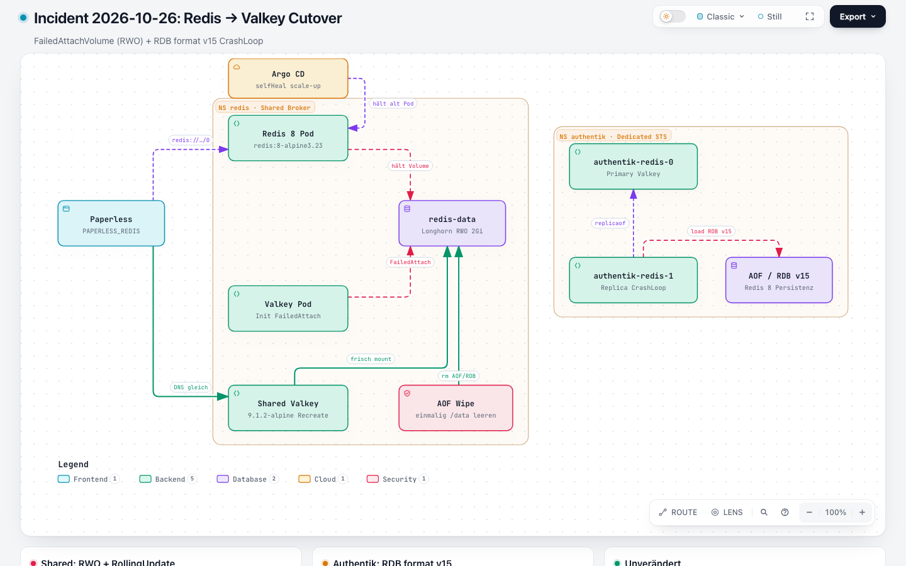
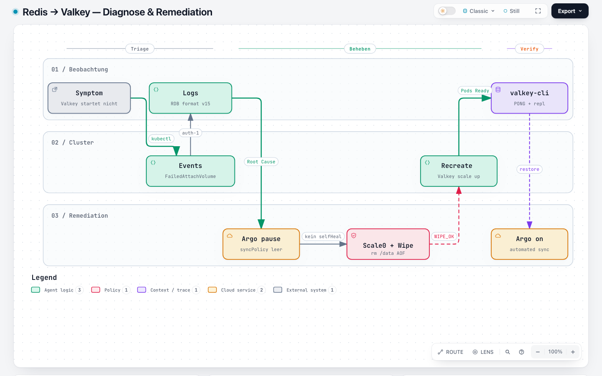
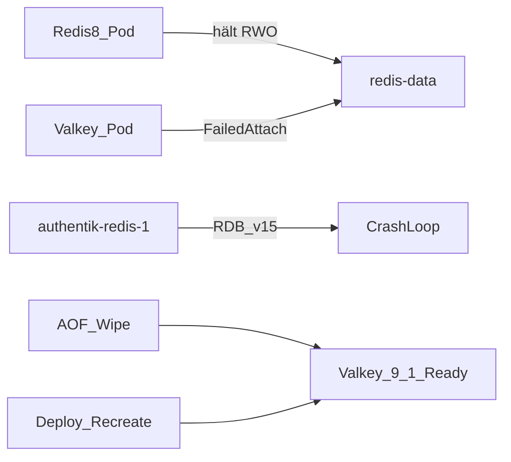

# Incident 2026-10-26: Redis → Valkey Cutover

> **Buch** v1.10.0 · **Kapitel** v1.0.0 · Stand: 2026-10-26

Fehleranalyse: Nach dem Image-Wechsel auf `valkey/valkey:9.1.2-alpine` startete der **shared** Broker (`apps/infra/redis`) nicht; parallel crashte die Authentik-Replica. Paperless-DNS/`PAPERLESS_REDIS` blieben unverändert.

## Überblick

| | |
|--|--|
| **Symptom** | Shared: neuer Pod `Init` / `FailedAttachVolume`; Authentik: `authentik-redis-1` CrashLoop |
| **Root Cause** | (1) RollingUpdate + RWO-PVC dual-attach; (2) Valkey 9.1 kann Redis-8-AOF/RDB (**format v15**) nicht laden |
| **Impact** | Shared Broker und Authentik-Task/Cache während Cutover; Apps erwarteten weiter Redis-Protokoll |
| **Sofortfix** | Argo sync pausieren → scale 0 → `/data` wipen → Recreate / STS scale 2 |
| **Dauerhaft** | Deploy `strategy: Recreate`; Cutover-Hinweis in READMEs |

Verwandt: Buch **Authentik** → Incident Redis→Valkey; [`apps/infra/redis/README.md`](../../../../apps/infra/redis/README.md); Deploy & Verify (Valkey-Checks).

## Architektur (Fehler- vs. Sollpfad)



Explorer: [`redis-valkey-cutover-incident.html`](https://github.com/HenryHST/minilab/blob/main/docs/diagrams/archify/redis-valkey-cutover-incident.html) · Spec: `docs/diagrams/archify/redis-valkey-cutover-incident.json` · SVG: `docs/diagrams/archify/exports/redis-valkey-cutover-incident.svg`

## Diagnose-Ablauf



Explorer: [`redis-valkey-cutover-diagnose.html`](https://github.com/HenryHST/minilab/blob/main/docs/diagrams/archify/redis-valkey-cutover-diagnose.html) · Spec: `docs/diagrams/archify/redis-valkey-cutover-diagnose.json` · SVG: `docs/diagrams/archify/exports/redis-valkey-cutover-diagnose.svg`

## Symptom

- Shared: Deployment-Image bereits Valkey; alter Pod noch `redis:8-alpine3.23` Running; neuer Pod hängt in `Init:0/1`
- Authentik: `authentik-redis-0` noch Redis 8; `authentik-redis-1` Valkey mit Restart-Schleife
- Paperless Env unverändert: `redis://redis.redis.svc.cluster.local:6379/0`

## Checks (Laufzeitbeweis)

```bash
kubectl -n redis get pods,deploy -o wide
kubectl -n redis describe pod -l app=redis | rg -A3 'FailedAttach|Image:|State:'
kubectl -n redis get events --sort-by=.lastTimestamp | tail -20

kubectl -n authentik get pods -l app.kubernetes.io/component=redis -o wide
kubectl -n authentik logs authentik-redis-1 --tail=30
```

**Befund 2026-10-26:**

| Check | Ergebnis |
|-------|----------|
| Shared Event | `FailedAttachVolume` — PVC already used by old Redis-8-Pod |
| Shared strategy | RollingUpdate `maxSurge`/`maxUnavailable` 25 % |
| Auth `-1` Log | `Can't handle RDB format version 15` / `AOF loading aborted` |
| Auth `-0` | noch `redis:8-alpine3.23`, `redis_version:8.10.2` |
| Image-Pull | ok (`valkey/valkey:9.1.2-alpine`) |

## Hypothesen

| ID | Hypothese | Status |
|----|-----------|--------|
| A | RWO-PVC + RollingUpdate blockiert neuen Pod | **bestätigt** |
| B | Valkey lädt Redis-8-RDB v15 nicht | **bestätigt** |
| C | STS OrderedReady steckt bei Replica-Crash | **bestätigt** |
| D | Image-Pull fehlgeschlagen | verworfen |
| E | `valkey-cli`-Probes sind die Ursache | verworfen (Exit vor Ready) |

## Ursache

1. Shared Longhorn-PVC `redis-data` ist **RWO**. RollingUpdate startet den Valkey-Pod, bevor der Redis-8-Pod das Volume freigibt → Attach wartet endlos.
2. Redis 8 schreibt AOF/RDB mit **Format 15**. Valkey 9.1.2 bricht beim Laden ab (`AOF loading aborted`).
3. Authentik-STS `OrderedReady` aktualisiert zuerst `-1`; CrashLoop verhindert den Rollout von `-0`.
4. Argo **selfHeal** skaliert Deployments während eines Wipe-Jobs wieder hoch → Wipe selbst sieht `FailedAttachVolume`.



## Sofortfix

```bash
# Argo auto-sync aus (sonst selfHeal)
kubectl -n argocd patch application redis --type json \
  -p '[{"op":"replace","path":"/spec/syncPolicy","value":{}}]'
kubectl -n argocd patch application authentik --type json \
  -p '[{"op":"replace","path":"/spec/syncPolicy","value":{}}]'

# Shared: scale 0 → Wipe → Recreate/Valkey
kubectl -n redis scale deploy/redis --replicas=0
# Job busybox: find /data -mindepth 1 -maxdepth 1 -exec rm -rf {} +
kubectl apply -f apps/infra/redis/redis.yaml   # strategy Recreate
kubectl -n redis scale deploy/redis --replicas=1

# Authentik: STS 0 → beide PVCs wipen → scale 2
kubectl -n authentik scale sts/authentik-redis --replicas=0
# Wipe data-authentik-redis-0 und data-authentik-redis-1
kubectl apply -f apps/ops/authentik/redis.yaml
kubectl -n authentik scale sts/authentik-redis --replicas=2
```

Verifikation:

```bash
kubectl -n redis exec deploy/redis -- valkey-cli ping
kubectl -n authentik exec authentik-redis-0 -- valkey-cli ping
kubectl -n authentik exec authentik-redis-0 -- valkey-cli info replication | rg 'role|connected_slaves'
kubectl -n authentik exec authentik-redis-1 -- valkey-cli info replication | rg 'role|master_link_status'
```

Danach Argo `syncPolicy.automated` wieder setzen.

## Dauerhafter Fix (Git)

- [`apps/infra/redis/redis.yaml`](../../../../apps/infra/redis/redis.yaml): `strategy.type: Recreate`
- READMEs: Cutover-Hinweis RDB v15 / einmaliger Wipe (Broker/Cache only)
- Commit-Beispiel: `a88666c` — `fix(redis): Recreate strategy and document Valkey AOF wipe`

## Lessons Learned

- **RWO + RollingUpdate** bei Single-Replica-Deployments vermeiden → **Recreate**.
- Redis 8 → Valkey 9 ist **kein** Drop-in für Persistenzdaten; AOF/RDB einmalig leeren (Sessions/Broker ok).
- Wipe nur bei **pausiertem** Argo-selfHeal.
- DNS/Env der Apps bleiben Redis-Protokoll; Verify mit `valkey-cli`.

## Quellen

| Ressource | Pfad |
|-----------|------|
| Shared Manifest | `apps/infra/redis/redis.yaml` |
| Shared README | `apps/infra/redis/README.md` |
| Authentik STS | `apps/ops/authentik/redis.yaml` |
| Archify Incident | `docs/diagrams/archify/redis-valkey-cutover-incident.*` |
| Archify Diagnose | `docs/diagrams/archify/redis-valkey-cutover-diagnose.*` |
| Authentik-Kapitel | Buch Authentik → Incident 2026-10-26 |
