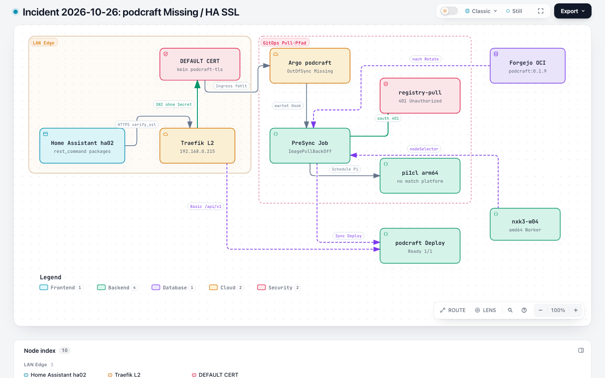
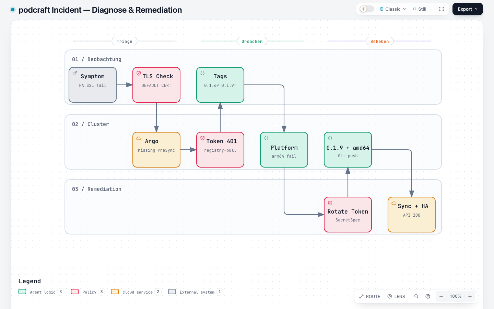
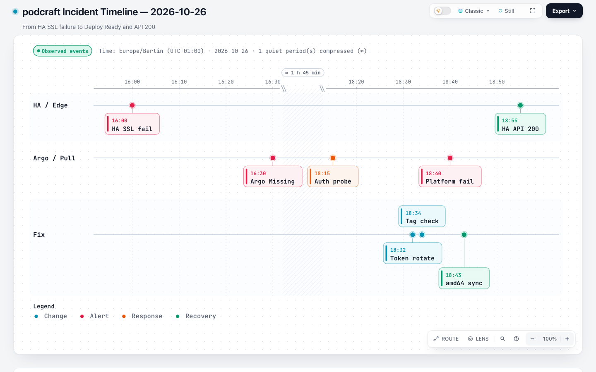

# Incident 2026-10-26: podcraft Missing / HA SSL

> **Buch** v1.1.0 · **Kapitel** v1.0.0 · Stand: 2026-10-26

Fehleranalyse: Home Assistant **ha02** konnte `https://podcraft.stadthagen.dev` nicht nutzen, weil die Argo-App **podcraft** im Cluster fehlte (`Missing`) und Traefik nur das **DEFAULT CERT** auslieferte. Dahinter lagen drei unabhängige Pull-/Schedule-Fehler plus ein offenes ACME-DNS-Thema.

## Überblick

| | |
|--|--|
| **Symptom** | HA `rest_command` / Sensoren: SSL-Fehler; Browser/curl: Certificate subject mismatch |
| **Oberfläche** | Traefik `CN=TRAEFIK DEFAULT CERT` für `podcraft.stadthagen.dev` |
| **Root Causes** | (1) `registry-pull` → Forgejo `/v2/token` **401** · (2) Image-Tag **0.1.6** nicht in der Registry (**404**) · (3) PreSync/Deploy auf **arm64** (Pi) trotz amd64-only Image |
| **Impact** | Kein Deploy, kein IngressRoute/Certificate → keine HA-Remediation/Start-Stop für drawio/it-tools |
| **Sofortfix** | Forgejo-Token rotieren → SecretSpec/`--tags secrets` → Image **0.1.9** + `nodeSelector: kubernetes.io/arch=amd64` → Argo sync → HA Basic Secret + vorübergehend `verify_ssl: false` |
| **Offen** | Let's-Encrypt `podcraft-tls`: ACME-TXT in Hetzner Cloud API sichtbar, auf autoritativen NS (`hydrogen…`) nicht → Cert `Ready=False` |

Verwandt: [Home Assistant](02-home-assistant.md) · Übersicht: [podcraft](01-uebersicht.md).

## Architektur (Fehler- vs. Sollpfad)



Explorer: [`podcraft-incident-2026-10-26.html`](https://github.com/HenryHST/minilab/blob/main/docs/diagrams/archify/podcraft-incident-2026-10-26.html) · Spec: `docs/diagrams/archify/podcraft-incident-2026-10-26.json`

## Diagnose-Ablauf



Explorer: [`podcraft-diagnose-2026-10-26.html`](https://github.com/HenryHST/minilab/blob/main/docs/diagrams/archify/podcraft-diagnose-2026-10-26.html) · Spec: `docs/diagrams/archify/podcraft-diagnose-2026-10-26.json`

## Timeline



Explorer: [`podcraft-timeline-2026-10-26.html`](https://github.com/HenryHST/minilab/blob/main/docs/diagrams/archify/podcraft-timeline-2026-10-26.html) · Spec: `docs/diagrams/archify/podcraft-timeline-2026-10-26.json`

## Symptom & Checks (Schritte)

### 1) TLS von ha02 / LAN

```bash
curl -vI https://podcraft.stadthagen.dev/healthz
# oder
echo | openssl s_client -connect 192.168.0.215:443 \
  -servername podcraft.stadthagen.dev 2>/dev/null \
  | openssl x509 -noout -subject -ext subjectAltName
```

**Befund:** `CN=TRAEFIK DEFAULT CERT` — kein Secret `podcraft-tls`.

### 2) Argo / Namespace

```bash
kubectl -n argocd get application podcraft \
  -o jsonpath='sync={.status.sync.status} health={.status.health.status}{"\n"}'
kubectl -n podcraft get deploy,ingressroute,certificate,job 2>&1
```

**Befund:** `OutOfSync` / `Missing`; oft nur Secret `registry-pull` + fehlgeschlagener PreSync-Job. Operation-Message: *waiting for hook* / *Resource not found: podcraft-image-pull-…* (Hook-Pod nach `DeadlineExceeded` gelöscht).

### 3) ImagePull-Events

```bash
kubectl -n podcraft describe job podcraft-image-pull
kubectl -n podcraft get events --sort-by=.lastTimestamp | tail -30
```

**Typische Meldungen (chronologisch aufgetreten):**

| Event | Bedeutung |
|-------|-----------|
| `401 Unauthorized` auf `…/v2/token?…repository:dev/podcraft:pull` | Pull-Secret ungültig |
| `no match for platform in manifest` auf **pi1cl** | Image nur linux/amd64 |
| `Resource not found …-cr92n` in Argo UI | Job hat Pod nach Timeout gelöscht; Argo-Retry |

### 4) Registry-Auth ohne Secret-Leak

In-Cluster-Probe mit gemountetem `registry-pull` (nur Statuscodes loggen):

```text
token_status=401   → Credentials tot
token_status=200 + manifest_0.1.6=404 + manifest_0.1.9=200
                   → Auth OK, falsches Tag
```

`forgejo admin user list`: User **`registry`** existiert (aktiv, kein Admin).

### 5) SecretSpec vs. Cluster

```bash
cd ansible/playbooks/k3s_cluster/secrets
SECRETSPEC_PROFILE=cluster secretspec check | grep REGISTRY_
# Länge vergleichen (keine Werte ausgeben):
# secretspec export --format json | jq '.REGISTRY_PASSWORD|length'
```

Früher: SecretSpec und Cluster hatten dasselbe **ungültige** Passwort (Länge 44) → `--tags secrets` mit `changed=0` half nicht.

## Hypothesen

| ID | Hypothese | Status | Evidenz |
|----|-----------|--------|---------|
| A | Secret `registry-pull` fehlt | **verworfen** | Secret seit 2026-10-21 vorhanden |
| B | Credentials ungültig (401) | **bestätigt** | Token-Endpoint mit Secret → `UNAUTHORIZED` |
| C | Falscher Registry-Host | **verworfen** | Host `git.stadthagen.dev` korrekt |
| D | Image-Tag 0.1.6 fehlt | **bestätigt** | Manifest 404; 0.1.9 = 200 |
| E | Stale Hook-Pod in Argo | **bestätigt (Symptom)** | Pod nach Deadline gelöscht |
| F | arm64-Scheduling | **bestätigt** | `no match for platform` auf pi1cl |
| G | ACME DNS publiziert nicht | **bestätigt (offen)** | TXT in Cloud API, leer auf hydrogen NS; SOA-Serial seit 2026-10-22 |

## Sofortfix (ausgeführt)

### A) Registry-Token

```bash
# Auf Forgejo-Pod (Beispiel):
forgejo admin user generate-access-token \
  -c /data/gitea/conf/app.ini \
  --username registry \
  --token-name "k8s-registry-pull-$(date +%Y%m%d)" \
  --scopes "read:package" --raw

cd ansible/playbooks/k3s_cluster/secrets
SECRETSPEC_PROFILE=cluster secretspec set REGISTRY_PASSWORD   # neuen Token
SECRETSPEC_PROFILE=cluster secretspec set REGISTRY_USER -- registry
cd ..
ansible-playbook site.yaml --tags secrets --limit nxk3-cp01
```

Erwartung: `PLAY RECAP … changed≥1` für `registry-pull`; erneute Token-Probe → **200**.

### B) Image + Architektur (Git)

- Deploy + PreSync-Job: `git.stadthagen.dev/dev/podcraft:0.1.9`
- `nodeSelector: kubernetes.io/arch: amd64` (Deploy + Job)

Commits (minilab): `b0b60c9` (Tag), `4eb2ab7` (amd64).

### C) Argo Sync

```bash
kubectl -n argocd patch application podcraft --type json \
  -p '[{"op":"remove","path":"/operation"}]'   # steckengebliebene Retries
kubectl -n podcraft delete job podcraft-image-pull --wait=true
# hard refresh + sync revision main
```

Erwartung: Job **Complete** auf Worker (z. B. `nxk3-w04`), Deploy **Ready**, IngressRoute vorhanden.

### D) HA auf ha02

1. `input_boolean`s in `packages/podcraft.yaml` wieder aktiv (waren auskommentiert).
2. Secret `podcraft-ha-basic` (`username`/`password`) anlegen bzw. in der UI rotieren.
3. Bis LE-Cert steht: `verify_ssl: false` in den `rest_command`/`rest`-Blöcken.
4. YAML neu laden; Smoke:

```bash
# von ha02, Basic aus secrets.yaml — Erwartung HTTP 200
curl -sk -u "$user:$pass" \
  https://podcraft.stadthagen.dev/api/v1/workloads/drawio
```

Verifiziert: **HTTP 200** mit drawio desired/ready.

## Offenes Thema: Certificate / DNS

| Check | Ergebnis |
|-------|----------|
| Certificate `podcraft-stadthagen-dev` | `Ready=False`, Secret `podcraft-tls` fehlt |
| Challenge | DNS-01 pending: *record not yet propagated* |
| Hetzner Cloud API | TXT `_acme-challenge.podcraft` vorhanden |
| NS `hydrogen.ns.hetzner.com` | TXT **leer**; andere alte `_acme-challenge.*` noch sichtbar |
| SOA `stadthagen.dev` | Serial `2026102205` (Stand Diagnose) |

Webhook: `cert-manager-webhook-hetzner:v0.9.0` schreibt in die **Cloud-DNS-API**; autoritative Auslieferung für neue RRSets wirkte zum Incident-Zeitpunkt inkonsistent. **Folge:** Traefik bleibt ohne `podcraft-tls` beim Default-Cert — deshalb HA vorübergehend ohne TLS-Verify.

**Nächste Schritte (Ops):** Hetzner-Zone/NS-Publishing prüfen; nach sichtbarem TXT Challenge abwarten; dann auf ha02 `verify_ssl: true` zurücksetzen.

## Lessons Learned

- PreSync-Image-Pull und Deploy-Image/Tag müssen **identisch** und in der Registry **vorhanden** sein.
- amd64-only Lab-Images dürfen nicht auf Pi-Agents landen → expliziter `nodeSelector`.
- `registry-pull` regelmäßig mit Token-Probe gegen `/v2/token` prüfen; SecretSpec-Wert ≠ gültige Forgejo-Auth.
- Argo „Resource not found“ auf Hook-Pods ist oft **Folge** von Job-Deadline, nicht die Root Cause.
- HA-Package: dokumentierter Host ist **ha02** (nicht mehr pi5cl); Automationen brauchen die `input_boolean`s.

## Quellen

| Ressource | Pfad |
|-----------|------|
| Deploy / Job | `apps/dev/podcraft/deployment.yaml`, `image-pull-job.yaml` |
| Ingress / Cert | `ingressroute.yaml`, `certificate.yaml` |
| HA-Beispiel | `examples/homeassistant/podcraft.yaml` |
| SecretSpec | Infra_LAB `ansible/…/secrets/secretspec.toml` (`REGISTRY_*`) |
| Archify Incident | `docs/diagrams/archify/podcraft-incident-2026-10-26.*` |
| Archify Diagnose | `docs/diagrams/archify/podcraft-diagnose-2026-10-26.*` |
| Archify Timeline | `docs/diagrams/archify/podcraft-timeline-2026-10-26.*` |
