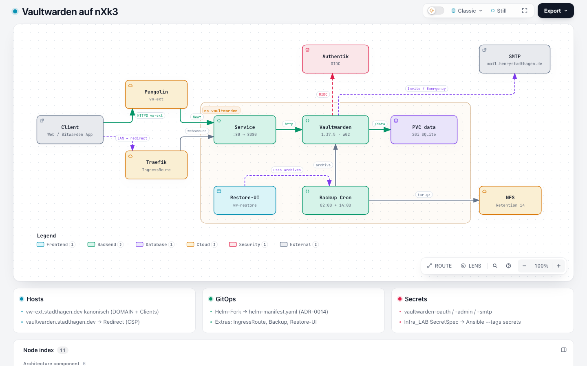

# Übersicht

Vaultwarden ist der Bitwarden-kompatible Passwort-Safe im nXk3-Cluster. Login läuft über Authentik-OIDC; Web-Vault und Clients nutzen den öffentlichen Host `vw-ext`. Deploy folgt ADR-0014: lokaler Helm-Fork → committed `helm-manifest.yaml`.

Explorer: [vaultwarden-architektur.html](https://github.com/HenryHST/minilab/blob/main/docs/diagrams/archify/vaultwarden-architektur.html)

| | |
|--|--|
| Argo App | `vaultwarden` (ApplicationSet `dev`, Wave 3, Plain Directory) |
| Pfad | `apps/dev/vaultwarden/` |
| Chart | `charts/vaultwarden` Fork `1.4.2+minilab.1` (Upstream gissilabs 1.4.2) |
| Manifest | `helm-manifest.yaml` (+ Plain Extras) |
| Image | `vaultwarden/server:1.37.5` |
| Namespace | `vaultwarden` |
| Node | `nxk3-w02` |
| URL (kanonisch) | https://vw-ext.stadthagen.dev |
| LAN-Alias | `https://vaultwarden.stadthagen.dev` → Redirect auf `vw-ext` |
| Login | Authentik-OIDC, Slug `vaultwarden` — Gruppen `vaultwarden_admins` / `vaultwarden_users` |
| SMTP | `mail.henrystadthagen.de:465` (`force_tls`), Secret `vaultwarden-smtp` |
| Emergency Access | explizit aktiv (`EMERGENCY_ACCESS_ALLOWED`) |
| Push | bewusst aus |
| Speicher | PVC `vaultwarden-data` 2Gi Longhorn RWO (`/data`, SQLite) |
| Backup | CronJob 02:00 + 14:00 UTC → NFS, Retention 14 |
| Restore-UI | https://vw-restore.stadthagen.dev (`vaultwarden_admins`) |

## Ownership

| Concern | Owner |
|---------|--------|
| Chart-Fork + `helm-manifest.yaml` + Extras | minilab GitOps |
| OIDC-App, Redirects, Gruppen | Infra_LAB `terraform/authentik` |
| Secrets (`vaultwarden-oauth`, `-admin`, `-smtp`) | Infra_LAB SecretSpec → Ansible `--tags secrets` |
| Pangolin Publish (`vw-ext`) | minilab `apps/ops/pangolin-publish` |

## Abgrenzung

- Kein ForwardAuth an Pangolin (`sso: false`) — die App macht OIDC selbst.
- BookStack behält LAN-Launch; Vaultwarden Web/SSO/Clients sind **nur** `vw-ext` (siehe [Hosts & DOMAIN](02-hosts-domain.md)).
- Kein Native-Argo-`helmRepo` — Chart ist lokal, Runtime unabhängig von gissilabs (siehe [Helm & GitOps](05-helm-gitops.md)).
- Endnutzer-Kurzguide: Anleitung **Zugang & Passwörter**.

Weiter: [OIDC](03-oidc-authentik.md) · [Helm](05-helm-gitops.md) · [SMTP & Emergency](09-smtp-emergency.md) · [Betrieb](10-betrieb.md).
