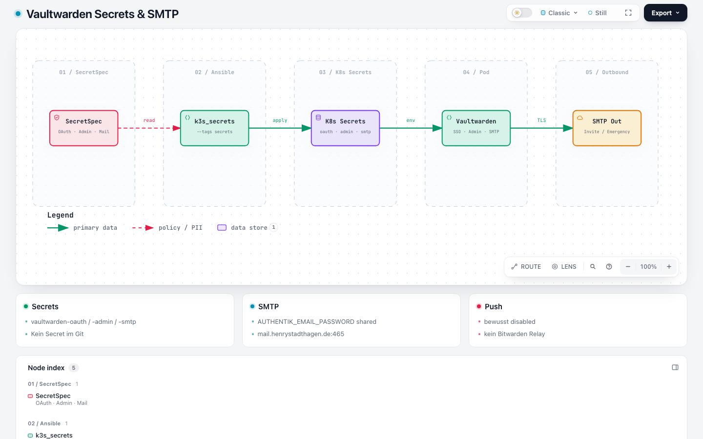

# Secrets

Keine Secrets im Git. Source of Truth: Infra_LAB SecretSpec → Ansible `--tags secrets` → Kubernetes.



Explorer: [vaultwarden-smtp-secrets.html](https://github.com/HenryHST/minilab/blob/main/docs/diagrams/archify/vaultwarden-smtp-secrets.html)

| SecretSpec | K8s Secret | Keys / Env |
|------------|------------|------------|
| `VAULTWARDEN_OAUTH_CLIENT_SECRET` | `vaultwarden/vaultwarden-oauth` | `SSO_CLIENT_SECRET` |
| `VAULTWARDEN_ADMIN_TOKEN` | `vaultwarden/vaultwarden-admin` | `ADMIN_TOKEN` (Admin-Panel) |
| `AUTHENTIK_EMAIL_PASSWORD` | `vaultwarden/vaultwarden-smtp` | `smtp-user` (literal `auto@…`), `smtp-password` |

Kein Push-Secret. Chart erzeugt in Prod keine Secrets (`existingSecret` überall).

## Admin-Token lesen

```bash
kubectl -n vaultwarden get secret vaultwarden-admin \
  -o jsonpath='{.data.ADMIN_TOKEN}' | base64 -d; echo

# oder SoT:
secretspec get VAULTWARDEN_ADMIN_TOKEN --profile cluster --provider cluster_age
```

Admin-UI: `https://vw-ext.stadthagen.dev/admin`

## Pin mit Terraform

1. Authentik-Client-Secret in `dev.secrets.tfvars` als `vaultwarden_oauth_client_secret` setzen (gleicher Wert wie SecretSpec).
2. `./scripts/reconcile.sh dev` bzw. `--tags authentik-bootstrap`.
3. `ansible-playbook … --tags secrets` — Secrets im Cluster aktualisieren (inkl. `vaultwarden-smtp`).
4. Vaultwarden-Pod neu starten / Rollout, falls Env schon geladen war.

Für Pangolin-Ext braucht es **keine** zusätzlichen SecretSpec-Keys — nur Redirects/`DOMAIN`.

Runbook: Infra_LAB `ansible/playbooks/k3s_cluster/secrets/README.md` und k3s-README Abschnitt *Vaultwarden SSO*. SMTP/Emergency: [09-smtp-emergency.md](09-smtp-emergency.md).
