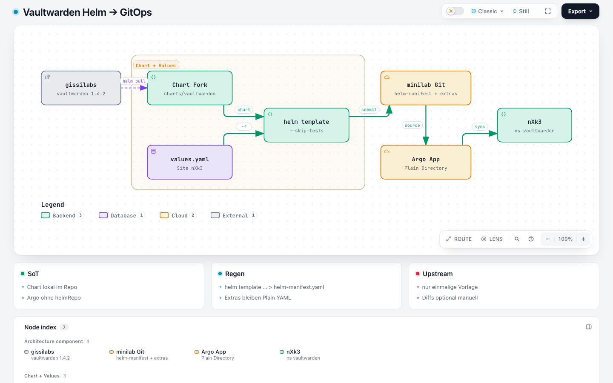

# Helm & GitOps

Vaultwarden folgt [ADR-0014](../../../../adr/0014-helm-strategie.md): User-Apps rendern Charts lokal und committen `helm-manifest.yaml`. Argo synct ein **Plain Directory** — kein Live-`helmRepo`.



Explorer: [vaultwarden-helm-gitops.html](https://github.com/HenryHST/minilab/blob/main/docs/diagrams/archify/vaultwarden-helm-gitops.html)

## Layout

```
apps/dev/vaultwarden/
  charts/vaultwarden/     # Fork (Chart.yaml 1.4.2+minilab.1)
  values.yaml             # Site-Values nXk3
  helm-manifest.yaml      # gerendert, committed
  pvc.yaml                # existingClaim vaultwarden-data
  ingressroute.yaml       # LAN + sso-to-ext (nicht Chart)
  certificate.yaml
  middleware-*.yaml
  networkpolicy.yaml
  backup-cronjob.yaml
  restore-*.yaml / restore-ui-*
```

ApplicationSet (`dev`):

```yaml
- app: vaultwarden
  path: apps/dev/vaultwarden
  namespace: vaultwarden
  syncWave: "3"
```

## Regenerieren

Nach Änderungen an Chart oder Site-Values:

```bash
cd apps/dev/vaultwarden
helm template vaultwarden ./charts/vaultwarden \
  -f values.yaml --namespace vaultwarden --skip-tests > helm-manifest.yaml
```

`--skip-tests` lässt den Helm-Test-Hook (`templates/tests/`) aus dem Manifest.

## Fork vs. Upstream

| | |
|--|--|
| Herkunft | einmalig `helm pull gissilabs/vaultwarden --version 1.4.2` |
| Runtime | **unabhängig** — Chart liegt in minilab |
| Minilab-Diff | Secret-Keys `ADMIN_TOKEN` / `SSO_CLIENT_*`, Probes `/alive`, SSO Client-ID als Value, IngressRoute-Annotations |
| Upstream nachziehen | optional `helm pull` + `diff -ru` — kein Automatismus / kein Renovate auf dem Fork |

Chart-Unit-Tests unter `charts/vaultwarden/tests/` (helm-unittest) sind mitvendored; minilab führt sie nicht in CI aus.

## Was nicht im Chart liegt

Restore-UI, PreSync Image-Pull, NFS-Backup, `middleware-sso-to-ext`, NetworkPolicy, Certificate — bleiben Plain YAML (wie BookStack-Extras).

Weiter: [Secrets](04-secrets.md) · [SMTP & Emergency](09-smtp-emergency.md) · [Quellen](11-quellen.md).
