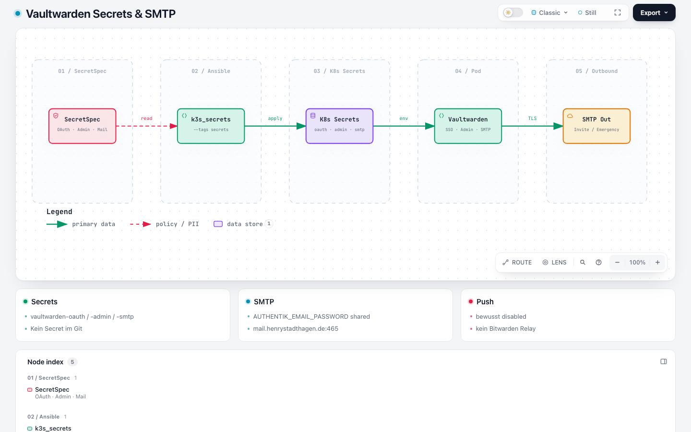

# SMTP & Emergency Access

SMTP und Emergency Access gehören zusammen: Reminder- und Timeout-Mails brauchen einen funktionierenden Mailer. Push-Notifications bleiben bewusst aus.



Explorer: [vaultwarden-smtp-secrets.html](https://github.com/HenryHST/minilab/blob/main/docs/diagrams/archify/vaultwarden-smtp-secrets.html)

## SMTP (Lab-Parität)

Gleicher Mailer wie Authentik / BookStack / Paperless / Forgejo:

| Setting | Wert |
|---------|------|
| Host | `mail.henrystadthagen.de` |
| Port | `465` |
| Security | `force_tls` |
| From / User | `auto@henrystadthagen.de` |
| From name | `Vaultwarden` |
| Secret | `vaultwarden-smtp` Keys `smtp-user`, `smtp-password` |
| Password SoT | SecretSpec `AUTHENTIK_EMAIL_PASSWORD` (kein eigener VW-Key) |

Site-Values (`apps/dev/vaultwarden/values.yaml`):

```yaml
vaultwarden:
  smtp:
    enabled: true
    host: mail.henrystadthagen.de
    port: "465"
    security: force_tls
    from: auto@henrystadthagen.de
    fromName: Vaultwarden
    existingSecret: vaultwarden-smtp
```

Infra_LAB legt das Secret mit `--tags secrets` an (siehe [Secrets](04-secrets.md)).

## Emergency Access

Ermöglicht einem Vertrauensnutzer nach Wartezeit View/Takeover des Vaults (Bitwarden-Feature).

```yaml
vaultwarden:
  emergency:
    enabled: true
    reminder: "0 3 * * * *"
    timeout: "0 7 * * * *"
```

**Nutzen:** Kontinuität bei Ausfall des Kontoinhabers, kontrollierter Prozess mit Wartezeit.

**Risiken:** Vertrauensperson wählen; Social Engineering; ohne SMTP unzuverlässig. Ersetzt kein NFS-/PVC-Backup.

In der Web-UI unter Account → Emergency Access konfigurierbar, sobald SMTP greift.

## Push — bewusst aus

`vaultwarden.push.enabled: false`. Kein Installation ID/Key von bitwarden.com, kein `vaultwarden-push` Secret. Begründung: Abhängigkeit vom Bitwarden-Cloud-Relay; für das Lab kein Bedarf.

## Verify

- [ ] Einladung per Mail (Admin oder Org) kommt an
- [ ] Emergency Access in der UI sichtbar / Kontakt einladbar
- [ ] Pod-Env enthält `SMTP_HOST`, `EMERGENCY_ACCESS_ALLOWED=true`
- [ ] Keine `PUSH_*` Env-Vars

```bash
kubectl -n vaultwarden get secret vaultwarden-smtp
kubectl -n vaultwarden exec deploy/vaultwarden -- env | grep -E 'SMTP_|EMERGENCY_|PUSH_'
```

Weiter: [Betrieb](10-betrieb.md) · [Secrets](04-secrets.md).
