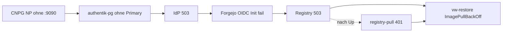

# Incident 2026-11-04: vw-restore ImagePullBackOff (IdP/Registry-Kaskade)

> **Buch** v1.3.0 · **Kapitel** v1.0.0 · Stand: 2026-11-04

Einstiegssymptom war der Argo-PreSync-Job **`vw-restore-image-pull`** (`ErrImagePull` / `ImagePullBackOff`, Manifest-HEAD **503**). Die Ursache lag **nicht** am Digest oder am Job selbst, sondern an einer Plattform-Kaskade ab Authentik/CNPG.

**Ausführliche Fehleranalyse, Hypothesen, Runbook und Abgrenzung:** Infra_LAB Buch **Authentik Runtime** → [Incident 2026-11-04: IdP/Registry-Kaskade](https://github.com/HenryHST/Infra_LAB/blob/main/docs/bookstack/books/authentik/13-incident-2026-11-04-idp-registry-cascade.md).

## Kurzfassung



| Stufe | Befund | Fix |
|-------|--------|-----|
| 1 | Operator erreicht barman-cloud gRPC **:9090** nicht | NetworkPolicy Egress 9090 (minilab `cloudnative-pg`) |
| 2 | `authentik-pg` Plugin-Phase / dangling PVC | Orphan-PVC-Adopt (`cnpg.io/nodeSerial`) |
| 3 | IdP OIDC Discovery 503 | Primary Ready → Server/Worker |
| 4 | Forgejo `configure-gitea` OIDC sync | Pod neu, wenn Discovery 200 |
| 5 | Registry wieder da, Pull **401** | PAT reminten → SecretSpec → `--tags secrets` |
| 6 | PreSync | Job neu → **Complete 1/1** |

## Vaultwarden-spezifische Checks

```bash
kubectl -n vaultwarden get job vw-restore-image-pull
kubectl -n vaultwarden get events --sort-by=.lastTimestamp | grep vw-restore | tail -20

# 503 = Registry/Forgejo/IdP-Kaskade; 401 auf /v2/token = Pull-Secret
curl -sS -o /dev/null -w 'git_v2=%{http_code}\n' https://git.stadthagen.dev/v2/
curl -sS -o /dev/null -w 'oidc=%{http_code}\n' \
  https://idp.stadthagen.dev/application/o/forgejo/.well-known/openid-configuration
```

Ownership PreSync/Secret: Infra_LAB [vw-restore: Pull-Secret & Ownership](https://github.com/HenryHST/Infra_LAB/blob/main/docs/bookstack/books/k3s/11-vw-restore-image-pull.md). Job-Manifest: `apps/dev/vaultwarden/restore-ui-image-pull-job.yaml`.

## Was hier *nicht* helfen würde

- Digest/SemVer am PreSync ändern, solange `git_v2=503`
- Nur Argo Sync der App `vaultwarden` wiederholen ohne IdP/Forgejo
- `registry-pull` anfassen, bevor die Registry wieder **401** (alive) statt **503** liefert — außer der Fehler ist bereits Auth-401

## Quellen

- Hauptanalyse: Infra_LAB Authentik `13-incident-2026-11-04-idp-registry-cascade.md`
- CNPG NP: `apps/infra/cloudnative-pg/manifests/networkpolicy.yaml` (Egress TCP 9090)
- Restore-UI Betrieb: [Backup & Restore](08-backup-restore.md)
